# Learn .NET 🟣

<div align="center">

[](https://opensource.org/licenses/MIT)
[](https://dotnet.microsoft.com/)
[](https://github.com/TheLearningHubOrg/learn-dot-net/actions/workflows/ci.yml)
[](https://github.com/TheLearningHubOrg/learn-dot-net/releases)
[](https://learn.microsoft.com/aspnet/core/)
[](https://learn.microsoft.com/ef/core/)

**From your first `dotnet new` to staff-level ASP.NET Core: the platform, the request pipeline, dependency injection, EF Core, security, resilience and production operations on .NET 10 LTS.**  
C# 14, Kestrel, minimal APIs, middleware, options, EF Core 10, JWT and policies, background services, SignalR, gRPC, HybridCache, Polly, OpenTelemetry, containers and Native AOT.

[Getting Started](#1-stage-1-net-platform-c--the-aspnet-core-host) • [Pipeline & APIs](#2-stage-2-request-pipeline-middleware-routing--minimal-apis) • [DI & Data](#3-stage-3-dependency-injection-options--ef-core-data-access) • [Security & Workers](#4-stage-4-security-background-work--real-time) • [APIs & Testing](#5-stage-5-api-design-grpc--testing) • [Production](#6-stage-6-performance-resilience-observability--deployment) • [Interview Prep](#7-stage-7-staff-net-backend-engineer-interview-handbook--cheatsheet)

<br/>

<a href="https://www.buymeacoffee.com/manthanank">
  
</a>

</div>

---

All code in this guide is **C#**. C# is the language the .NET SDK templates, the ASP.NET Core and EF Core documentation, and nearly every library in the ecosystem are written for. F# and Visual Basic also run on .NET, but ASP.NET Core features such as minimal API source generators and Razor are designed C#-first. The starter project in this repository ([`src/LearnDotNet.Api`](src/LearnDotNet.Api)) and its xUnit tests ([`tests/LearnDotNet.Tests`](tests/LearnDotNet.Tests)) are the running versions of the Stage 1-3 examples.

## 🗺️ 7-Stage Pedagogical Roadmap

```mermaid
flowchart LR
    S1["Stage 1: Platform & Host"] --> S2["Stage 2: Pipeline & Minimal APIs"]
    S2 --> S3["Stage 3: DI, Options & EF Core"]
    S3 --> S4["Stage 4: Security & Background Work"]
    S4 --> S5["Stage 5: API Design, gRPC & Testing"]
    S5 --> S6["Stage 6: Performance & Operations"]
    S6 --> M["Masterclasses M1-M5"]
    M --> S7["Stage 7: Staff Interview Handbook"]
```

| Stage | Focus Domain | Core Concepts & Engineering Outcomes |
| :--- | :--- | :--- |
| **Stage 1** | **.NET Platform, C# & the ASP.NET Core Host** | CLR, JIT and GC; `dotnet new`, `dotnet run`, `global.json`; SDK-style `.csproj`; C# records, nullable reference types, pattern matching, primary constructors; `WebApplication.CreateBuilder`; Kestrel ports and limits; configuration layering, `dotnet user-secrets`, `ILogger<T>`. Outcome: run, configure and explain a minimal web host. |
| **Stage 2** | **Request Pipeline, Middleware, Routing & Minimal APIs** | `RequestDelegate`, `app.Use`, convention middleware and `IMiddleware`; middleware order; route templates and constraints; parameter binding, `TypedResults`, `Results<T1,T2>`; `MapGroup`, `IEndpointFilter`; .NET 10 `AddValidation()`; `IExceptionHandler` and RFC 9457 problem details. Outcome: a correct, well-behaved HTTP API surface. |
| **Stage 3** | **Dependency Injection, Options & EF Core Data Access** | `IServiceCollection`, transient/scoped/singleton, scope validation, `IServiceScopeFactory`, keyed services; `IOptions<T>`, `IOptionsSnapshot<T>`, `ValidateOnStart`; `DbContext`, relationships, LINQ projection, tracking, migrations, `ExecuteUpdateAsync`, optimistic concurrency, pooling and compiled queries. Outcome: a persistent, testable service layer. |
| **Stage 4** | **Security, Background Work & Real-Time** | JWT bearer validation, authorization policies and handlers, `BackgroundService`, `PeriodicTimer`, SignalR hubs and the Redis backplane. |
| **Stage 5** | **API Design, gRPC & Testing** | Protocol Buffers, gRPC server streaming, API contracts, xUnit and `WebApplicationFactory<Program>`. |
| **Stage 6** | **Performance, Resilience, Observability & Deployment** | `HybridCache`, Polly v8 resilience pipelines, health checks for Kubernetes probes, OpenTelemetry traces and metrics. |
| **Masterclasses** | **Kestrel internals, resilience, Native AOT, observability, flagship order service** | Deep dives that reuse everything from Stages 1-6. |
| **Stage 7** | **Staff Interview Handbook** | Interview Q&As on internals, design trade-offs and production debugging, plus a cheatsheet. |

---

## 🆕 .NET Versions, What's New & Migration

### V.1 Release Timeline

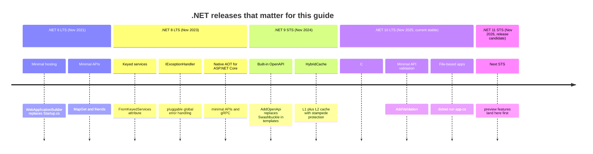

.NET ships every November. Even-numbered releases are **LTS** (three years of patches); odd-numbered releases are **STS**, which Microsoft extended from 18 to 24 months starting with .NET 9. Patch releases arrive on the second Tuesday of most months, so "10.0" is a feature band and the patch number (`10.0.x`) keeps moving.

### V.2 Compatibility Matrix

| .NET | Released | Supported until | C# | EF Core | IDE support | Notes |
| --- | --- | --- | --- | --- | --- | --- |
| 6 (LTS) | Nov 2021 | Nov 2024 (ended) | 10 | 6 | Visual Studio 2022 | Introduced minimal hosting and minimal APIs. |
| 7 (STS) | Nov 2022 | May 2024 (ended) | 11 | 7 | Visual Studio 2022 | Route groups, endpoint filters, rate limiting middleware. |
| 8 (LTS) | Nov 2023 | 10 Nov 2026 | 12 | 8 | Visual Studio 2022 17.8+ | Primary constructors, keyed services, `IExceptionHandler`, `TimeProvider`, port 8080 in container images. |
| 9 (STS) | Nov 2024 | 10 Nov 2026 | 13 | 9 | Visual Studio 2022 17.12+ | Built-in OpenAPI, `MapStaticAssets`, EF Core `UseSeeding`. |
| **10 (LTS)** | **Nov 2025** | **Nov 2028** | **14** | **10** | Visual Studio 2026, Rider, VS Code with C# Dev Kit | **The target of this guide.** |
| 11 (STS) | Nov 2026 (expected) | current preview | current preview | 11 | current preview tooling | Release candidates are available; do not target it in production until GA. |

.NET 8 and .NET 9 both leave support on the same day in November 2026. Anything still on them should move straight to .NET 10.

### V.3 What's New in .NET 10

#### File-based apps

A single `.cs` file now runs without a project. Package and SDK references go in `#:` directives at the top. It is the fastest way to try a snippet from this guide.

Before (.NET 9): create a project first.

```bash
dotnet new console -o Scratch && cd Scratch && dotnet run
```

After (.NET 10):

```csharp
// hello.cs  -> run with: dotnet run hello.cs
#:package Humanizer.Core@2.14.1
using Humanizer;

Console.WriteLine(TimeSpan.FromMinutes(90).Humanize());
```

`dotnet project convert hello.cs` turns the file into a normal project when it outgrows one file.

#### Minimal API validation

Before, minimal APIs ignored `[Required]` and `[Range]`, so every project wrote its own endpoint filter (Stage 2.8 shows one). .NET 10 adds a source-generated validator.

```csharp
// Before (.NET 8/9): a hand-written filter on every endpoint
group.MapPost("/notes", AddNote).AddEndpointFilter<ValidationFilter<NewNote>>();

// After (.NET 10): one registration, attributes are enforced everywhere
builder.Services.AddValidation();
group.MapPost("/notes", AddNote);

public record NewNote([Required, StringLength(280, MinimumLength = 3)] string Text);
```

Invalid input now gets a `400` validation problem before the handler runs. The starter project relies on this: [`Program.cs`](src/LearnDotNet.Api/Program.cs) and [`Models/RoadmapStage.cs`](src/LearnDotNet.Api/Models/RoadmapStage.cs).

#### C# 14: the `field` keyword and extension members

```csharp
// Before: a backing field just to trim a value
public class Tag
{
    private string _name = "";
    public string Name { get => _name; set => _name = value.Trim(); }
}

// After: the compiler supplies the backing field
public class Tag
{
    public string Name { get; set => field = value.Trim(); } = "";
}
```

Extension members let one `extension` block add properties and static members, not only methods:

```csharp
public static class StringExtensions
{
    extension(string s)
    {
        public bool IsBlank => string.IsNullOrWhiteSpace(s);
        public string Truncate(int max) => s.Length <= max ? s : s[..max];
    }
}

// "   ".IsBlank == true
```

Null-conditional assignment (`customer?.LastSeen = now;`) assigns only when the left side is not null.

#### OpenAPI 3.1 and the end of `WithOpenApi`

`AddOpenApi()` now emits OpenAPI 3.1 documents, and the `WithOpenApi()` extension is deprecated. Metadata such as `WithSummary`, `WithDescription`, `WithTags` and `Produces<T>` feeds the generator directly.

```csharp
// Before
app.MapGet("/stages", GetAll).WithOpenApi();

// After
app.MapGet("/stages", GetAll).WithSummary("List all stages");
```

#### EF Core 10

- `LeftJoin` and `RightJoin` LINQ operators replace the `GroupJoin` + `SelectMany` + `DefaultIfEmpty` pattern.
- Named query filters: several `HasQueryFilter("SoftDelete", ...)` filters per entity, each disabled independently with `IgnoreQueryFilters(["SoftDelete"])`.
- `ExecuteUpdateAsync` accepts an ordinary lambda, so setters can be built with `if` statements instead of expression trees.

```csharp
// Before: GroupJoin gymnastics for a left join
var rows = db.Stages.GroupJoin(db.Notes, s => s.Id, n => n.StageId, (s, ns) => new { s, ns })
    .SelectMany(x => x.ns.DefaultIfEmpty(), (x, n) => new { x.s.Title, Note = n == null ? null : n.Text });

// After
var rows2 = db.Stages.LeftJoin(db.Notes, s => s.Id, n => n.StageId,
    (s, n) => new { s.Title, Note = n == null ? null : n.Text });
```

#### SDK and CLI

- Noun-first commands: `dotnet package add`, `dotnet package list`, `dotnet reference add` sit beside the old verb-first forms.
- `dotnet new sln` creates the XML-based `.slnx` format by default.
- `dnx` (an alias of `dotnet tool exec`) runs a .NET tool once without installing it.

### V.4 Migration Guide (.NET 8 / 9 → .NET 10)

```bash
# 1. Install the .NET 10 SDK and pin it for the repository
dotnet --list-sdks
dotnet new globaljson --sdk-version 10.0.100 --roll-forward latestFeature

# 2. Retarget every project (or set it once in Directory.Build.props)
#    <TargetFramework>net8.0</TargetFramework>  ->  <TargetFramework>net10.0</TargetFramework>

# 3. Find outdated packages and move Microsoft.* packages to 10.0.x
dotnet package list --outdated
dotnet package add Microsoft.EntityFrameworkCore.Sqlite --version 10.0.14

# 4. Rebuild with warnings as errors to surface new obsoletion warnings
dotnet build -warnaserror

# 5. Update container base images
#    mcr.microsoft.com/dotnet/aspnet:8.0  ->  mcr.microsoft.com/dotnet/aspnet:10.0

# 6. Update the EF Core CLI tool and check that the model has no pending changes
dotnet tool update --global dotnet-ef
dotnet ef migrations has-pending-model-changes
```

Code changes that most ASP.NET Core 8/9 apps need:

1. Replace `Swashbuckle.AspNetCore` with `builder.Services.AddOpenApi()` + `app.MapOpenApi()`, and add a UI package (for example Scalar or Swagger UI) only if you need one.
2. Delete `.WithOpenApi()` calls.
3. Replace hand-written validation endpoint filters with `AddValidation()`.
4. Re-run the test suite: EF Core 10 changes how parameterized collections (`ids.Contains(x.Id)`) are translated, which can change query plans.

### V.5 Deprecations & Breaking Changes

| Version | Deprecated / removed | Replacement | What breaks and how to fix it |
| --- | --- | --- | --- |
| .NET 6 | `Startup.cs` with `ConfigureServices`/`Configure` as the default | `WebApplication.CreateBuilder` | Still supported through the generic host, but templates and docs use minimal hosting. Move registrations to `builder.Services` and the pipeline after `builder.Build()`. |
| .NET 8 | Port 80 in official container images | Port 8080 (`ASPNETCORE_HTTP_PORTS`) | Containers that published `-p 80:80` get no response. Map `8080`, or set `ASPNETCORE_HTTP_PORTS`. |
| .NET 8 | Running containers as root | `USER $APP_UID` (the `app` user, UID 1654, added to the images in .NET 8) | Images still default to root unless you switch users. After switching, writes to root-owned `/app` fail with permission denied: write to `/tmp` or a mounted volume. |
| .NET 9 | Swashbuckle in the `webapi` template | `Microsoft.AspNetCore.OpenApi` | New projects have no `/swagger` UI. Serve `/openapi/v1.json` and add a UI package if needed. |
| .NET 9 | `BinaryFormatter` | `System.Text.Json`, Protocol Buffers, MessagePack | The implementation was removed; calls throw `PlatformNotSupportedException`. |
| .NET 10 | `WithOpenApi()` | Endpoint metadata methods, document transformers | Obsoletion warning; fails builds that use `TreatWarningsAsErrors`. |
| .NET 10 | `WebHostBuilder`, `IWebHost` | `WebApplication.CreateBuilder`, `Host.CreateApplicationBuilder` | Obsoletion warnings on legacy hosting code. |
| RFC 7807 | Problem Details RFC 7807 | RFC 9457 | Same JSON shape; RFC 9457 obsoletes 7807. Update references in docs and contracts. |

---

## 📋 Table of Contents

- [🆕 .NET Versions, What's New & Migration](#-net-versions-whats-new--migration)
- [1. Stage 1: .NET Platform, C# & the ASP.NET Core Host](#1-stage-1-net-platform-c--the-aspnet-core-host)
  - [1.1 What .NET Is and the Problem It Solves](#11-what-net-is-and-the-problem-it-solves)
  - [1.2 Installing the SDK & First Run](#12-installing-the-sdk--first-run)
  - [1.3 SDK-Style Projects, Solutions & NuGet](#13-sdk-style-projects-solutions--nuget)
  - [1.4 C# Essentials for ASP.NET Core Code](#14-c-essentials-for-aspnet-core-code)
  - [1.5 WebApplicationBuilder and the Generic Host](#15-webapplicationbuilder-and-the-generic-host)
  - [1.6 Kestrel: Endpoints, Ports, Limits and Protocols](#16-kestrel-endpoints-ports-limits-and-protocols)
  - [1.7 Configuration, Environments and Secrets](#17-configuration-environments-and-secrets)
  - [1.8 Logging with `ILogger<T>`](#18-logging-with-ilogger)
  - [1.9 Line-by-Line Breakdown of the Starter Project](#19-line-by-line-breakdown-of-the-starter-project)
  - [1.10 Pitfalls](#110-pitfalls)
  - [1.11 Best Practices](#111-best-practices)
  - [1.12 Hands-on Exercise](#112-hands-on-exercise)
- [2. Stage 2: Request Pipeline, Middleware, Routing & Minimal APIs](#2-stage-2-request-pipeline-middleware-routing--minimal-apis)
  - [2.1 The Bidirectional Delegate Chain (`RequestDelegate`)](#21-the-bidirectional-delegate-chain-requestdelegate)
  - [2.2 Middleware Order in a Real Application](#22-middleware-order-in-a-real-application)
  - [2.3 Writing Custom Middleware: Inline, Convention-Based and `IMiddleware`](#23-writing-custom-middleware-inline-convention-based-and-imiddleware)
  - [2.4 Endpoint Routing: Templates, Constraints and Precedence](#24-endpoint-routing-templates-constraints-and-precedence)
  - [2.5 Minimal API Handlers and Parameter Binding](#25-minimal-api-handlers-and-parameter-binding)
  - [2.6 Results: `IResult`, `TypedResults` and `Results<T1, T2>`](#26-results-iresult-typedresults-and-results)
  - [2.7 Route Groups and Endpoint Filters (`IEndpointFilter`)](#27-route-groups-and-endpoint-filters-iendpointfilter)
  - [2.8 Input Validation: .NET 10 `AddValidation()` and the Filter It Replaces](#28-input-validation-net-10-addvalidation-and-the-filter-it-replaces)
  - [2.9 Error Handling: `IExceptionHandler` and Problem Details (RFC 9457)](#29-error-handling-iexceptionhandler-and-problem-details-rfc-9457)
  - [2.10 Minimal APIs vs MVC Controllers](#210-minimal-apis-vs-mvc-controllers)
  - [2.11 Pitfalls](#211-pitfalls)
  - [2.12 Best Practices](#212-best-practices)
  - [2.13 Hands-on Exercise](#213-hands-on-exercise)
- [3. Stage 3: Dependency Injection, Options & EF Core Data Access](#3-stage-3-dependency-injection-options--ef-core-data-access)
  - [3.1 How the DI Container Works](#31-how-the-di-container-works)
  - [3.2 Service Lifetimes and the Captive Dependency Problem](#32-service-lifetimes-and-the-captive-dependency-problem)
  - [3.3 Scopes Outside a Request: `IServiceScopeFactory`](#33-scopes-outside-a-request-iservicescopefactory)
  - [3.4 Keyed Services (.NET 8+)](#34-keyed-services-net-8)
  - [3.5 The Options Pattern: Typed, Validated Configuration](#35-the-options-pattern-typed-validated-configuration)
  - [3.6 EF Core: `DbContext`, Entities and Relationships](#36-ef-core-dbcontext-entities-and-relationships)
  - [3.7 Querying: LINQ Translation, Projection and Tracking](#37-querying-linq-translation-projection-and-tracking)
  - [3.8 Migrations: Evolving the Schema Safely](#38-migrations-evolving-the-schema-safely)
  - [3.9 Saving Data: Change Tracking, Bulk Updates and Transactions](#39-saving-data-change-tracking-bulk-updates-and-transactions)
  - [3.10 Optimistic Concurrency](#310-optimistic-concurrency)
  - [3.11 DbContext Pooling and Compiled Queries](#311-dbcontext-pooling-and-compiled-queries)
  - [3.12 Testing the Data Layer](#312-testing-the-data-layer)
  - [3.13 Pitfalls](#313-pitfalls)
  - [3.14 Best Practices](#314-best-practices)
  - [3.15 Hands-on Exercise](#315-hands-on-exercise)
- [4. Stage 4: Security, Background Work & Real-Time](#4-stage-4-security-background-work--real-time)
  - [4.1 Securing Web APIs with JWT Bearer Authentication](#41-securing-web-apis-with-jwt-bearer-authentication)
  - [4.2 Custom Policy Authorization Handlers](#42-custom-policy-authorization-handlers)
  - [4.3 Scalable Real-Time Push with SignalR and a Redis Backplane](#43-scalable-real-time-push-with-signalr-and-a-redis-backplane)
  - [4.4 Periodic Background Services (`BackgroundService`)](#44-periodic-background-services-backgroundservice)
- [5. Stage 5: API Design, gRPC & Testing](#5-stage-5-api-design-grpc--testing)
  - [5.1 gRPC Service Implementation](#51-grpc-service-implementation)
- [6. Stage 6: Performance, Resilience, Observability & Deployment](#6-stage-6-performance-resilience-observability--deployment)
  - [6.1 `HybridCache`: L1 + L2 Caching with Stampede Protection](#61-hybridcache-l1--l2-caching-with-stampede-protection)
  - [6.2 Polly v8 Resilience Pipelines](#62-polly-v8-resilience-pipelines)
  - [6.3 Health Checks for Kubernetes Probes](#63-health-checks-for-kubernetes-probes)
  - [6.4 OpenTelemetry Traces and Metrics](#64-opentelemetry-traces-and-metrics)
  - [6.5 Pitfalls](#65-pitfalls)
- [M1. Masterclass: Kestrel, Pipelines & the Request Hot Path](#m1-masterclass-kestrel-pipelines--the-request-hot-path)
- [M2. Masterclass: Resilience Engineering with Polly v8 and HybridCache](#m2-masterclass-resilience-engineering-with-polly-v8-and-hybridcache)
- [M3. Masterclass: Native AOT, Trimming and Startup Performance](#m3-masterclass-native-aot-trimming-and-startup-performance)
- [M4. Masterclass: Observability with OpenTelemetry and .NET Aspire](#m4-masterclass-observability-with-opentelemetry-and-net-aspire)
- [M5. Masterclass: Flagship Blueprint: Resilient Order Management Service](#m5-masterclass-flagship-blueprint-resilient-order-management-service)
- [7. Stage 7: Staff .NET Backend Engineer Interview Handbook & Cheatsheet](#7-stage-7-staff-net-backend-engineer-interview-handbook--cheatsheet)
  - [7.1 Core Concepts (Q1-Q10)](#71-core-concepts-q1-q10)
  - [7.2 Internals & Performance (Q11-Q15)](#72-internals--performance-q11-q15)
- [🧪 Example Projects](#-example-projects)
- [📝 Cheat Sheets](#-cheat-sheets)
- [📚 Resources](#-resources)
- [🤝 Contributing](#-contributing)
- [📄 License](#-license)
- [🙏 Acknowledgments](#-acknowledgments)
- [🌐 Connect with me](#-connect-with-me)
- [☕ Support](#-support)

---

## 1. Stage 1: .NET Platform, C# & the ASP.NET Core Host

This stage covers what actually runs when you type `dotnet run`: the runtime, the SDK, the project file, the C# features every ASP.NET Core codebase leans on, and the web host with its Kestrel server and configuration system. You need a terminal and basic programming knowledge; no prior .NET experience is assumed. By the end you can create, configure, run and explain a minimal web host, and read every line of the starter project's `Program.cs`.

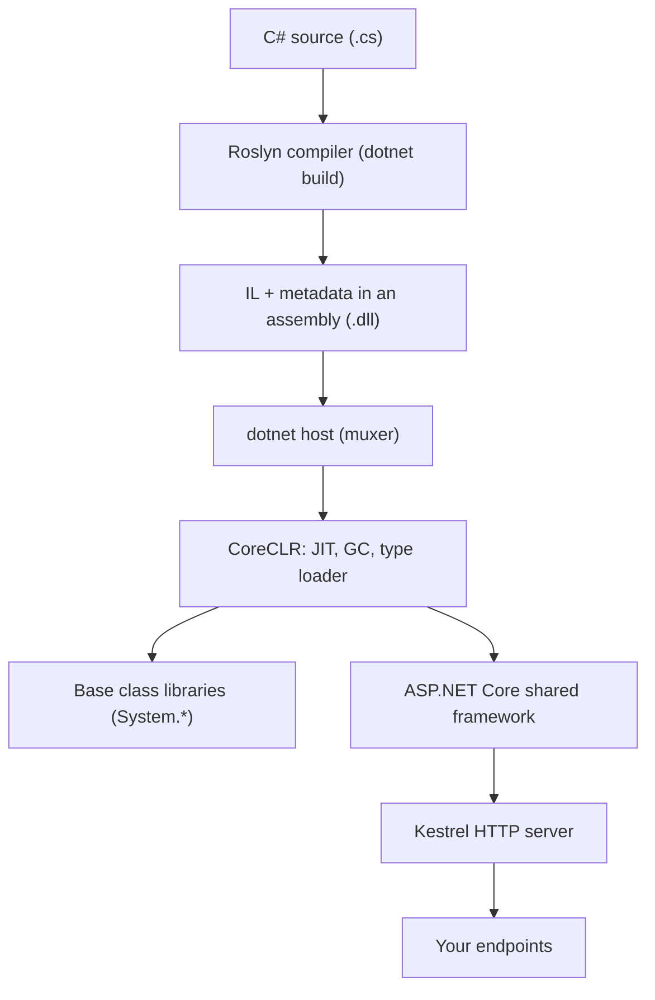

### 1.1 What .NET Is and the Problem It Solves

.NET is a managed runtime plus a large standard library plus a build toolchain. "Managed" means your code is compiled to an intermediate language (IL), and the runtime (CoreCLR) turns IL into machine code at run time with a just-in-time (JIT) compiler, manages memory with a generational garbage collector (GC), and enforces type safety. The same `.dll` runs on Windows, Linux and macOS, on x64 and Arm64.

The pieces you will meet by name:

| Piece | What it is | Where you see it |
| --- | --- | --- |
| **SDK** | Compilers, MSBuild, NuGet client, templates, the `dotnet` CLI | `dotnet --list-sdks`, the build stage of a Dockerfile |
| **Runtime** | CoreCLR plus the base class library (`Microsoft.NETCore.App`) | `dotnet --list-runtimes` |
| **Shared frameworks** | Extra framework libraries installed beside the runtime: `Microsoft.AspNetCore.App` for web apps | `<Project Sdk="Microsoft.NET.Sdk.Web">` pulls it in |
| **NuGet** | The package manager and the nuget.org registry | `<PackageReference>` in a `.csproj` |
| **ASP.NET Core** | The web framework: hosting, Kestrel, middleware, routing, minimal APIs, MVC, SignalR, gRPC | `WebApplication`, `MapGet` |
| **EF Core** | The object-relational mapper | `DbContext`, `dotnet ef` |

Tiered compilation keeps startup fast: methods first run as quickly produced "tier 0" code, and hot methods are recompiled with full optimisations ("tier 1"), using information gathered while running (dynamic PGO, on by default since .NET 8). For instant startup and small images you can instead compile ahead of time with Native AOT (covered in Masterclass M3).

How ASP.NET Core compares with other server stacks:

| Feature | ASP.NET Core (.NET 10) | Node.js (Fastify / NestJS) | Java (Spring Boot) | Go (net/http, Chi) | Python (FastAPI) |
| :--- | :--- | :--- | :--- | :--- | :--- |
| **I/O model** | Async I/O on a thread pool (epoll, kqueue, IOCP) | Single-threaded libuv event loop plus workers | Tomcat/Netty, virtual threads in Java 21+ | Goroutines on the runtime netpoller | asyncio event loop (uvloop) |
| **HTTP/3** | Built into Kestrel (needs `libmsquic` on Linux) | Experimental, usually a proxy in front | Usually a proxy in front | Through `quic-go` | Usually a proxy in front |
| **API style** | Minimal APIs or MVC controllers | Route handlers, decorators in NestJS | `@RestController` annotations | Plain handler functions | Decorated functions with Pydantic models |
| **Dependency injection** | Built into the host | NestJS container | Spring IoC container | Manual wiring or code generation (Wire) | `Depends()` |
| **Data access** | EF Core, Dapper, ADO.NET | Prisma, TypeORM, Drizzle | Spring Data JPA, Hibernate, jOOQ | `database/sql`, sqlx, GORM | SQLAlchemy |
| **Real time** | SignalR, WebSockets, server-sent events | Socket.IO, ws | Spring WebSocket | gorilla/websocket and others | WebSockets, SSE |
| **Resilience** | Polly v8, `Microsoft.Extensions.Http.Resilience` | opossum | Resilience4j | Hand-rolled or small libraries | tenacity |
| **Ahead-of-time binary** | Native AOT | Not applicable | GraalVM Native Image | Always compiled to a native binary | Not applicable |

### 1.2 Installing the SDK & First Run

Install the current .NET 10 SDK. The SDK includes the runtime, so you need nothing else to build and run.

```bash
# Windows
winget install Microsoft.DotNet.SDK.10

# macOS
brew install --cask dotnet-sdk

# Ubuntu (on 24.04 add the backports archive first; newer releases ship it directly)
sudo add-apt-repository ppa:dotnet/backports
sudo apt-get update && sudo apt-get install -y dotnet-sdk-10.0

# Any OS, no admin rights: the official install script
curl -sSL https://dot.net/v1/dotnet-install.sh | bash /dev/stdin --channel 10.0

# Check what is installed
dotnet --info
dotnet --list-sdks
dotnet --list-runtimes
```

Create and run a web API:

```bash
dotnet new webapi -o HelloApi       # minimal APIs are the default; add --use-controllers for MVC
cd HelloApi
dotnet run                          # builds, then starts Kestrel; the URL is printed
dotnet watch                        # rebuilds and hot-reloads on file changes
```

Pin the SDK per repository with `global.json`, so every developer and CI runner builds with the same feature band:

```json
{
  "sdk": {
    "version": "10.0.100",
    "rollForward": "latestFeature"
  }
}
```

`rollForward: latestFeature` accepts any newer 10.0.x SDK on the machine but refuses 11.0. Without a `global.json`, the newest installed SDK wins, which is how a preview SDK sneaks into a build.

Run this repository:

```bash
git clone https://github.com/TheLearningHubOrg/learn-dot-net.git
cd learn-dot-net
dotnet test                                 # 20 xUnit tests
dotnet run --project src/LearnDotNet.Api    # http://localhost:5080
curl http://localhost:5080/api/v1/roadmap/progress
```

### 1.3 SDK-Style Projects, Solutions & NuGet

A `.csproj` is an MSBuild file. The `Sdk` attribute imports hundreds of default targets and properties, so the file only states what differs from the defaults. This is the starter project's file:

```xml
<Project Sdk="Microsoft.NET.Sdk.Web">

  <PropertyGroup>
    <TargetFramework>net10.0</TargetFramework>
    <Nullable>enable</Nullable>
    <ImplicitUsings>enable</ImplicitUsings>
    <TreatWarningsAsErrors>true</TreatWarningsAsErrors>
    <InvariantGlobalization>true</InvariantGlobalization>
  </PropertyGroup>

  <ItemGroup>
    <PackageReference Include="Microsoft.AspNetCore.OpenApi" Version="10.0.14" />
    <PackageReference Include="Microsoft.EntityFrameworkCore.Sqlite" Version="10.0.14" />
  </ItemGroup>

</Project>
```

| Line | Role | What happens at build or run time |
| :--- | :--- | :--- |
| `Sdk="Microsoft.NET.Sdk.Web"` | Selects the web SDK | Adds a framework reference to `Microsoft.AspNetCore.App`, web-specific default usings, and publish settings. A class library uses `Microsoft.NET.Sdk`. |
| `TargetFramework` | Target framework moniker (TFM) | Decides which API surface the compiler sees and which runtime must be installed. `net10.0`; use `TargetFrameworks` (plural) to multi-target a library. |
| `Nullable` | Nullable reference types | `string` means "never null" and `string?` means "may be null"; violations become warnings, and here, errors. |
| `ImplicitUsings` | Global usings | Generates `global using System;`, `System.Linq`, `Microsoft.AspNetCore.Http` and others in `obj/`, so files skip boilerplate. |
| `TreatWarningsAsErrors` | Build gate | Nullability and obsoletion warnings fail the build instead of piling up. |
| `InvariantGlobalization` | Culture data | Skips loading ICU culture data. Smaller and faster in containers; only safe when you do not format for specific cultures. |
| `PackageReference` | NuGet dependency | Restored into the global packages folder (`~/.nuget/packages`); the resolved graph is written to `obj/project.assets.json`. |

Everyday commands:

```bash
dotnet new sln -n LearnDotNet                          # .slnx in .NET 10
dotnet sln add src/LearnDotNet.Api tests/LearnDotNet.Tests
dotnet package add Microsoft.EntityFrameworkCore.Sqlite --project src/LearnDotNet.Api
dotnet reference add src/LearnDotNet.Api --project tests/LearnDotNet.Tests
dotnet package list --outdated
dotnet build -c Release
dotnet publish src/LearnDotNet.Api -c Release -o out
```

Settings shared by every project belong in a `Directory.Build.props` at the repository root; MSBuild imports it automatically. Package versions can be centralised in `Directory.Packages.props` (central package management) so that two projects never reference different versions of the same package:

```xml
<!-- Directory.Packages.props -->
<Project>
  <PropertyGroup>
    <ManagePackageVersionsCentrally>true</ManagePackageVersionsCentrally>
  </PropertyGroup>
  <ItemGroup>
    <PackageVersion Include="Microsoft.EntityFrameworkCore.Sqlite" Version="10.0.14" />
    <PackageVersion Include="xunit" Version="2.9.3" />
  </ItemGroup>
</Project>
```

With central management on, each `.csproj` writes `<PackageReference Include="xunit" />` with no version.

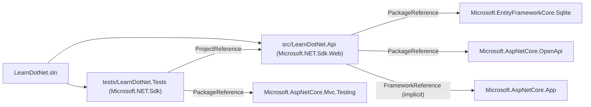

### 1.4 C# Essentials for ASP.NET Core Code

ASP.NET Core code uses a handful of modern C# features constantly. Save the block below as `essentials.cs` and run it with `dotnet run essentials.cs` (a .NET 10 file-based app).

```csharp
// essentials.cs
using System.Text.Json;

// 1. Records: immutable data with value equality and a readable ToString().
var a = new Stage(1, "Platform", ["dotnet CLI", "Kestrel"]);
var b = a with { Title = "Platform & Host" };   // non-destructive copy
Console.WriteLine(a == b);                      // False: values differ
Console.WriteLine(b);

// 2. Nullable reference types: the compiler tracks null.
string? maybe = args.Length > 0 ? args[0] : null;
Console.WriteLine(maybe?.ToUpperInvariant() ?? "(no argument)");

// 3. Pattern matching and switch expressions.
Console.WriteLine(Describe(404));
Console.WriteLine(Describe(201));

// 4. Collection expressions and spreads.
int[] firstThree = [1, 2, 3];
int[] all = [.. firstThree, 4, 5];
Console.WriteLine(string.Join(",", all));

// 5. Async all the way down.
var json = await SerializeAsync(b);
Console.WriteLine(json);

static string Describe(int status) => status switch
{
    >= 200 and < 300 => "success",
    404 => "not found",
    >= 400 and < 500 => "client error",
    _ => "server error",
};

static async Task<string> SerializeAsync(Stage stage)
{
    using var stream = new MemoryStream();
    await JsonSerializer.SerializeAsync(stream, stage, JsonSerializerOptions.Web);
    return System.Text.Encoding.UTF8.GetString(stream.ToArray());
}

// 6. Primary constructors: parameters are in scope for the whole class.
public sealed class Greeter(TimeProvider clock)
{
    public string Greet(string name) => $"Hello {name}, it is {clock.GetUtcNow():HH:mm} UTC";
}

public record Stage(int Number, string Title, IReadOnlyList<string> Topics);
```

| Feature | Where it shows up in ASP.NET Core | Watch out for |
| --- | --- | --- |
| Records | Request and response DTOs (`RoadmapStage`, `NewNote`) | `with` copies are shallow; a `List<T>` inside is shared. |
| Nullable reference types | Every `GetSection`, `FindFirst`, `FirstOrDefaultAsync` result | `!` (null-forgiving) silences the compiler but not the runtime `NullReferenceException`. |
| Switch expressions | Mapping exceptions or results to status codes | A missing `_` arm gives a warning and a runtime `SwitchExpressionException`. |
| Primary constructors | Services, middleware, handlers with injected dependencies | Parameters are mutable captured variables, not `readonly` fields; do not reassign them. |
| `async`/`await` | Every I/O call: EF Core, `HttpClient`, streams | `.Result` and `.Wait()` block a thread-pool thread (see 1.10). |
| Collection expressions | Seeding data, test assertions | `[..]` on an `IEnumerable<T>` enumerates it immediately. |

Async deserves one more paragraph because it is the most common source of production incidents in .NET services. `await` does not create a thread. It registers a continuation and returns the current thread to the pool, so a few dozen threads can serve thousands of requests waiting on a database. Blocking on a task (`task.Result`) holds a pool thread hostage while it waits; under load the pool runs out, new requests queue, and latency climbs even though CPU is idle. This is called thread-pool starvation.

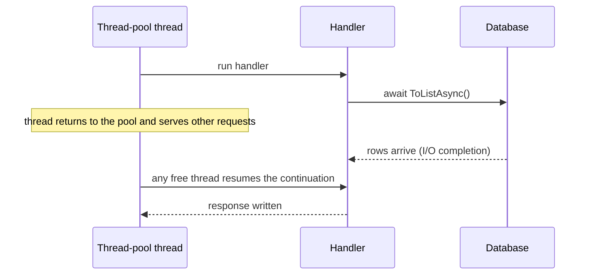

### 1.5 WebApplicationBuilder and the Generic Host

Before .NET 6, an ASP.NET Core application was split across `Program.cs` and a `Startup.cs` class with `ConfigureServices` and `Configure` methods. Minimal hosting collapses that into one file with three phases: create a builder, register services, build the app and describe the pipeline.

```csharp
var builder = WebApplication.CreateBuilder(args);

// Phase 1: configure Kestrel and register services. Nothing runs yet.
builder.WebHost.ConfigureKestrel(server =>
{
    server.Limits.MaxConcurrentConnections = 10_000;
    server.Limits.MaxRequestBodySize = 10 * 1024 * 1024; // 10 MB
    server.Limits.KeepAliveTimeout = TimeSpan.FromMinutes(2);
    server.Limits.RequestHeadersTimeout = TimeSpan.FromSeconds(15);
});

builder.Services.AddOpenApi();
builder.Services.AddHealthChecks();

// Phase 2: Build() freezes the service collection and creates the container.
var app = builder.Build();

// Phase 3: describe the middleware pipeline and the endpoints.
if (app.Environment.IsDevelopment())
{
    app.MapOpenApi();
}

app.UseHttpsRedirection();
app.MapHealthChecks("/health");
app.MapGet("/time", (TimeProvider clock) => new { utc = clock.GetUtcNow() });

app.Run();
```

`CreateBuilder` does a lot of work before your first line runs:

| Step inside `CreateBuilder(args)` | Effect |
| --- | --- |
| Sets the content root to the current directory | `appsettings.json` and `wwwroot` are found relative to it |
| Loads configuration (see 1.7) | `appsettings.json`, `appsettings.{Environment}.json`, user secrets in Development, environment variables, command-line args |
| Configures logging | Console, Debug and EventSource providers, filtered by the `Logging` section |
| Registers framework services | Routing, `IConfiguration`, `IWebHostEnvironment`, `IHostApplicationLifetime`, `ILogger<T>` and the options infrastructure |
| Turns on DI validation in Development | `ValidateScopes` and `ValidateOnBuild`, which catch captive dependencies (Stage 3.2) |
| Configures Kestrel as the server | Reads `Kestrel`, `ASPNETCORE_URLS` and `ASPNETCORE_HTTP_PORTS` settings |

`WebApplication` is three things at once: an `IHost` (it has `StartAsync`, `StopAsync` and `Services`), an `IApplicationBuilder` (so `Use...` methods add middleware) and an `IEndpointRouteBuilder` (so `Map...` methods add endpoints). That is why one object both builds the pipeline and runs the server.

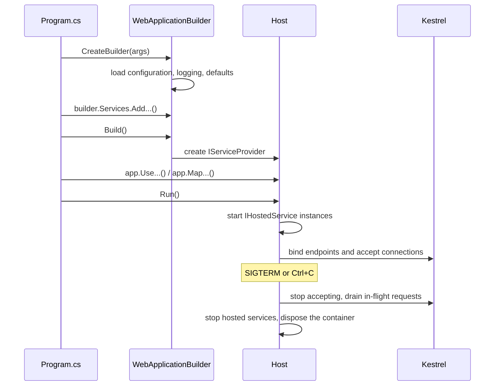

Graceful shutdown matters in containers. On `SIGTERM` the host stops accepting connections and waits for in-flight requests up to `HostOptions.ShutdownTimeout` (30 seconds by default). Kubernetes sends `SIGKILL` after `terminationGracePeriodSeconds` (also 30 by default), so keep the host timeout shorter than the pod's grace period.

For a worker with no HTTP surface, use the same host without the web parts:

```csharp
var builder = Host.CreateApplicationBuilder(args);
builder.Services.AddHostedService<QueueConsumer>();
await builder.Build().RunAsync();
```

### 1.6 Kestrel: Endpoints, Ports, Limits and Protocols

Kestrel is the cross-platform HTTP server inside every ASP.NET Core app. It accepts sockets, parses HTTP/1.1, HTTP/2 and HTTP/3 into `HttpContext` objects and hands them to your middleware. Its parser reads from `System.IO.Pipelines` buffers rented from a memory pool, so parsing a request allocates very little.

There are four ways to choose where Kestrel listens. Later sources override earlier ones:

| Mechanism | Example | Typical use |
| --- | --- | --- |
| Default | `http://localhost:5000` outside containers | Never rely on it |
| `ASPNETCORE_HTTP_PORTS` / `ASPNETCORE_HTTPS_PORTS` | `ASPNETCORE_HTTP_PORTS=8080` | Containers. The official images set `8080`, and it binds all interfaces. |
| `ASPNETCORE_URLS` or `--urls` | `--urls "http://0.0.0.0:8080;http://[::]:8080"` | Local scripts |
| `Kestrel` section in configuration, or `ConfigureKestrel` in code | below | TLS certificates, per-endpoint protocols and limits |

A container must bind to all interfaces. `localhost` inside a container is the container's own loopback, so `docker run -p 8080:8080` reaches nothing if Kestrel listens on `localhost:8080`.

```csharp
builder.WebHost.ConfigureKestrel(options =>
{
    // Plain HTTP on 8080 for the reverse proxy or the service mesh.
    options.ListenAnyIP(8080);

    // HTTPS on 5001 with HTTP/1.1, HTTP/2 and HTTP/3 (QUIC needs TLS 1.3).
    options.ListenAnyIP(5001, listen =>
    {
        listen.Protocols = Microsoft.AspNetCore.Server.Kestrel.Core.HttpProtocols.Http1AndHttp2AndHttp3;
        listen.UseHttps();
    });
});
```

The same thing as configuration, which ops teams can change without a rebuild:

```json
{
  "Kestrel": {
    "Endpoints": {
      "Http": { "Url": "http://0.0.0.0:8080" },
      "Https": {
        "Url": "https://0.0.0.0:5001",
        "Protocols": "Http1AndHttp2AndHttp3",
        "Certificate": { "Path": "/certs/api.pfx", "Password": "from-a-secret-store" }
      }
    },
    "Limits": { "MaxRequestBodySize": 10485760 }
  }
}
```

HTTP/3 on Linux needs the `libmsquic` package installed in the image; without it Kestrel logs a warning and serves HTTP/1.1 and HTTP/2 only. Clients discover HTTP/3 from the `Alt-Svc` response header, so the first request always arrives over TCP.

Most production deployments terminate TLS at a load balancer or ingress. Kestrel then sees plain HTTP from the proxy's IP, so `Request.Scheme` is `http` and `RemoteIpAddress` is the proxy. Forwarded headers middleware restores the original values, but only for proxies you trust:

```csharp
using Microsoft.AspNetCore.HttpOverrides;

builder.Services.Configure<ForwardedHeadersOptions>(options =>
{
    options.ForwardedHeaders = ForwardedHeaders.XForwardedFor | ForwardedHeaders.XForwardedProto;
    options.KnownIPNetworks.Add(System.Net.IPNetwork.Parse("10.0.0.0/8")); // your proxy subnet
});

var app = builder.Build();
app.UseForwardedHeaders(); // first, before anything reads Scheme or RemoteIpAddress
```

`KnownIPNetworks` (type `System.Net.IPNetwork`) is the .NET 10 name; older code uses `KnownNetworks` with the ASP.NET Core `IPNetwork` type, which is now obsolete.

### 1.7 Configuration, Environments and Secrets

Configuration in .NET is a flat dictionary of string keys built from layered providers. Keys use `:` as the separator (`Roadmap:MaxNotesPerStage`). Each provider can override the ones loaded before it.

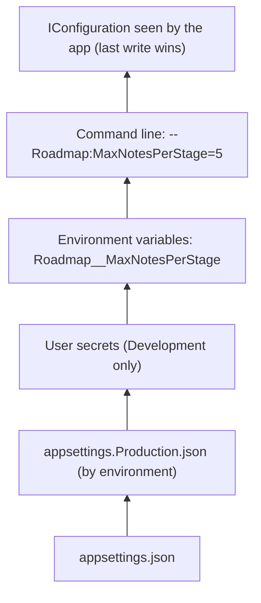

Environment variables cannot contain `:` on every OS, so a double underscore stands in for it: `ConnectionStrings__Roadmap` sets `ConnectionStrings:Roadmap`. The starter's Dockerfile uses exactly that to move the SQLite file into `/tmp`.

The environment comes from `ASPNETCORE_ENVIRONMENT` (or `DOTNET_ENVIRONMENT`) and defaults to `Production`. That default is a safety feature: forgetting to set it gives you production behaviour, not developer exception pages.

Reading configuration directly works, but Stage 3.5 shows the better way, strongly typed and validated options:

```csharp
var connection = builder.Configuration.GetConnectionString("Roadmap");          // ConnectionStrings:Roadmap
var max = builder.Configuration.GetValue<int>("Roadmap:MaxNotesPerStage", 20);   // with a default
var section = builder.Configuration.GetSection("Roadmap");                       // a subtree
```

Secrets never go in `appsettings.json`, because that file is committed. During development, use the user-secrets store, which lives in your user profile outside the repository:

```bash
dotnet user-secrets init --project src/LearnDotNet.Api
dotnet user-secrets set "Jwt:SigningKey" "a-long-random-development-only-value" --project src/LearnDotNet.Api
dotnet user-secrets list --project src/LearnDotNet.Api
```

In production, inject secrets as environment variables from the platform's secret store (Kubernetes secrets, AWS Secrets Manager, Azure Key Vault through its configuration provider). User secrets are not encrypted and load only in the Development environment.

`IConfiguration` reloads JSON files when they change (`reloadOnChange` is on for `appsettings*.json`). Code that holds a value it read at startup never sees the change; `IOptionsMonitor<T>` and `IOptionsSnapshot<T>` do (Stage 3.5).

### 1.8 Logging with `ILogger<T>`

ASP.NET Core logs through `Microsoft.Extensions.Logging`. You inject `ILogger<T>`, where `T` becomes the log category (usually the class's full name), and the `Logging:LogLevel` configuration filters by category prefix.

```csharp
public sealed class StageImporter(ILogger<StageImporter> logger)
{
    public void Import(string file, int count)
    {
        // A message template, not string interpolation: {File} and {Count}
        // become structured properties that log backends can index.
        logger.LogInformation("Imported {Count} stages from {File}", count, file);
    }
}
```

```json
{
  "Logging": {
    "LogLevel": {
      "Default": "Information",
      "Microsoft.AspNetCore": "Warning",
      "Microsoft.EntityFrameworkCore.Database.Command": "Warning"
    }
  }
}
```

Interpolated strings (`logger.LogInformation($"Imported {count}")`) defeat structured logging: the backend receives one opaque string, every distinct value creates a new message template, and the string is built even when the level is disabled. On hot paths, the `[LoggerMessage]` source generator produces allocation-free logging methods:

```csharp
public static partial class Log
{
    [LoggerMessage(Level = LogLevel.Warning, Message = "Note limit {Limit} reached for stage {Stage}")]
    public static partial void NoteLimitReached(ILogger logger, int stage, int limit);
}

// usage: Log.NoteLimitReached(logger, stageNumber, limit);
```

The starter's correlation middleware (Stage 2.3) wraps each request in `logger.BeginScope(...)`, so every log line written during that request carries the same `CorrelationId` property when the provider includes scopes (`"Console": { "IncludeScopes": true }` or a JSON console formatter).

### 1.9 Line-by-Line Breakdown of the Starter Project

The starter is a small roadmap API: seven stages stored in SQLite, completion tracking and per-stage notes. This is its whole [`Program.cs`](src/LearnDotNet.Api/Program.cs):

```csharp
using LearnDotNet.Api.Data;
using LearnDotNet.Api.Endpoints;
using LearnDotNet.Api.Errors;
using LearnDotNet.Api.Middleware;
using LearnDotNet.Api.Options;
using LearnDotNet.Api.Services;
using Microsoft.EntityFrameworkCore;

var builder = WebApplication.CreateBuilder(args);

builder.Services.AddOpenApi();
builder.Services.AddProblemDetails();
builder.Services.AddExceptionHandler<GlobalExceptionHandler>();
builder.Services.AddValidation();
builder.Services.AddHealthChecks();

builder.Services.AddOptions<RoadmapOptions>()
    .Bind(builder.Configuration.GetSection(RoadmapOptions.SectionName))
    .ValidateDataAnnotations()
    .ValidateOnStart();

builder.Services.AddDbContext<RoadmapDbContext>((sp, options) =>
    options.UseSqlite(sp.GetRequiredService<IConfiguration>().GetConnectionString("Roadmap"))
        .UseSeeding((context, _) => RoadmapSeed.Seed(context))
        .UseAsyncSeeding((context, _, ct) => RoadmapSeed.SeedAsync(context, ct)));

builder.Services.AddSingleton(TimeProvider.System);
builder.Services.AddScoped<IRoadmapService, RoadmapService>();

var app = builder.Build();

await using (var scope = app.Services.CreateAsyncScope())
{
    var db = scope.ServiceProvider.GetRequiredService<RoadmapDbContext>();
    await db.Database.EnsureCreatedAsync();
}

app.UseExceptionHandler();
app.UseStatusCodePages();
app.UseMiddleware<CorrelationIdMiddleware>();

if (app.Environment.IsDevelopment())
{
    app.MapOpenApi();
}

app.MapHealthChecks("/health");
app.MapGet("/", (Microsoft.Extensions.Options.IOptions<RoadmapOptions> options) => TypedResults.Ok(new
{
    name = options.Value.Title,
    framework = System.Runtime.InteropServices.RuntimeInformation.FrameworkDescription,
    endpoints = new[] { "/health", "/api/v1/roadmap", "/api/v1/roadmap/progress", "/api/v1/roadmap/metrics" },
}));
app.MapRoadmapEndpoints();

app.Run();

public partial class Program;
```

| Line / API | Role | What happens at runtime |
| :--- | :--- | :--- |
| `WebApplication.CreateBuilder(args)` | Host builder | Loads configuration, logging and defaults (1.5). |
| `AddOpenApi()` | OpenAPI document generator | Registers services that describe every endpoint; `MapOpenApi()` serves `/openapi/v1.json`. |
| `AddProblemDetails()` | Error body format | Registers `IProblemDetailsService`, used by the exception handler, status code pages and validation. |
| `AddExceptionHandler<GlobalExceptionHandler>()` | Error policy | Adds the handler that `UseExceptionHandler()` calls when a later component throws (2.9). |
| `AddValidation()` | .NET 10 minimal API validation | Validates `[Required]`/`[StringLength]` on handler parameters before the handler runs (2.8). |
| `AddOptions<RoadmapOptions>()...ValidateOnStart()` | Typed settings | Binds `Roadmap:*`, checks the attributes, and stops startup on invalid values (3.5). |
| `AddDbContext<RoadmapDbContext>((sp, options) => ...)` | Data access | Registers a scoped context. The lambda runs when a context is created, so tests can swap the connection string (3.6). |
| `UseSeeding` / `UseAsyncSeeding` | Seed data | Inserts the seven stages the first time the database is created. |
| `AddSingleton(TimeProvider.System)` | Clock abstraction | Services ask for `TimeProvider` instead of calling `DateTime.UtcNow`, so tests can pin time. |
| `AddScoped<IRoadmapService, RoadmapService>()` | Service layer | One instance per request, matching the `DbContext` it depends on (3.2). |
| `builder.Build()` | Freeze | Creates the root `IServiceProvider`. Registering services after this throws. |
| `CreateAsyncScope()` + `EnsureCreatedAsync()` | Startup task | Resolves a scoped `DbContext` outside a request and creates the schema. Production apps use migrations (3.8). |
| `UseExceptionHandler()` | First middleware | Wraps everything after it in a try/catch. |
| `UseStatusCodePages()` | Empty error bodies | Gives bodiless 4xx/5xx responses (for example a 404 from routing) a problem details body. |
| `UseMiddleware<CorrelationIdMiddleware>()` | Custom middleware | Adds `X-Correlation-ID` and a logging scope to every request (2.3). |
| `MapHealthChecks("/health")` | Liveness endpoint | Returns `Healthy` with 200; the CI smoke test and container probes call it. |
| `MapRoadmapEndpoints()` | Feature endpoints | An extension method in [`Endpoints/RoadmapEndpoints.cs`](src/LearnDotNet.Api/Endpoints/RoadmapEndpoints.cs) that maps a route group (2.7). |
| `app.Run()` | Start | Starts Kestrel and blocks until shutdown. |
| `public partial class Program;` | Test hook | Lets the test project reference the top-level-statement `Program` class in `WebApplicationFactory<Program>`. |

### 1.10 Pitfalls

| Pitfall | Symptom | Fix |
| --- | --- | --- |
| Kestrel bound to `localhost` inside a container | `curl: (52) Empty reply from server` or `connection refused` from the host | Use `ASPNETCORE_HTTP_PORTS=8080` (the images' default) or `http://0.0.0.0:8080`; do not set `ASPNETCORE_URLS=http://localhost:...` in the image. |
| Publishing port 80 for a .NET 8+ image | Container runs, no response on `-p 80:80` | The images listen on 8080; map `-p 8080:8080`. |
| No `global.json` and a preview SDK installed | `error NETSDK1045: The current .NET SDK does not support targeting .NET 11.0` on one machine, odd warnings on another | Commit a `global.json` with `rollForward: latestFeature`. |
| Blocking on async code (`.Result`, `.Wait()`, `GetAwaiter().GetResult()`) | Latency climbs under load while CPU stays low; thread-pool thread count grows by a couple per second | `await` end to end. Check with `dotnet-counters monitor System.Runtime` (thread-pool queue length). |
| Interpolated log messages | One log "message template" per distinct value; costs even when the level is off | Use message templates (`"Imported {Count}"`) or `[LoggerMessage]`. |
| Secrets in `appsettings.json` | Keys leaked through Git history | `dotnet user-secrets` locally, environment variables from a secret store in production. |
| `ASPNETCORE_ENVIRONMENT=Development` in a production image | Detailed exception pages and the OpenAPI document exposed | Leave it unset in images (defaults to `Production`). |
| Writing files to `/app` as the non-root `app` user | `SQLite Error 14: 'unable to open database file'` or `UnauthorizedAccessException` | Write to `/tmp` or a mounted volume, as the starter's Dockerfile does. |
| Missing forwarded headers behind a TLS-terminating proxy | Redirect loops with `UseHttpsRedirection`, wrong client IPs in logs | `UseForwardedHeaders()` first, with `KnownIPNetworks` set to the proxy range. |

### 1.11 Best Practices

- Pin the SDK with `global.json`: every build uses the same compiler and analyzers.
- Turn on `Nullable` and `TreatWarningsAsErrors` from the first commit: retrofitting them later produces thousands of warnings.
- Keep `Program.cs` to wiring only and move features into extension methods (`MapRoadmapEndpoints`): the composition root stays readable as the app grows.
- Read ports from `ASPNETCORE_HTTP_PORTS` rather than hard-coding them: the same image runs locally, in CI and in Kubernetes.
- Inject `TimeProvider` instead of calling `DateTime.UtcNow`: time-dependent code becomes testable.
- Log with message templates and stable property names: dashboards and alerts can query on them.
- Keep the host's shutdown timeout below the orchestrator's grace period: in-flight requests finish instead of being killed.
- Use the `Production` default for the environment and opt in to `Development` locally: insecure features stay off unless someone asks for them.

### 1.12 Hands-on Exercise

Add a `GET /api/v1/roadmap/about` endpoint that returns the configured title and the value of `Roadmap:MaxNotesPerStage`, then override the limit three ways and watch which one wins.

1. Map the endpoint in `RoadmapEndpoints.cs`, injecting `IOptionsSnapshot<RoadmapOptions>`.
2. Run `dotnet run --project src/LearnDotNet.Api` and call the endpoint: the limit is `20` from `appsettings.json`.
3. Restart with `Roadmap__MaxNotesPerStage=5 dotnet run --project src/LearnDotNet.Api`: the limit is `5`.
4. Restart with the environment variable still set and `-- --Roadmap:MaxNotesPerStage=7` on the command line: the limit is `7`, because command-line arguments are the last provider.
5. Start it with `Roadmap__MaxNotesPerStage=0`: the host refuses to start with an `OptionsValidationException`, because `[Range(1, 100)]` is validated on start.

Expected output for step 4:

```json
{ "title": "Learn .NET", "maxNotesPerStage": 7 }
```

The options class is [`Options/RoadmapOptions.cs`](src/LearnDotNet.Api/Options/RoadmapOptions.cs), and the test `Invalid_options_stop_the_host_at_startup` in [`tests/LearnDotNet.Tests/RoadmapApiTests.cs`](tests/LearnDotNet.Tests/RoadmapApiTests.cs) proves step 5.

[Back to top ⤴️](#-table-of-contents)

---

## 2. Stage 2: Request Pipeline, Middleware, Routing & Minimal APIs

This stage follows one HTTP request from Kestrel to your handler and back. It covers middleware (how it is built, ordered and written), endpoint routing, minimal API parameter binding and results, route groups and filters, .NET 10 validation, and error handling with problem details. It assumes Stage 1. Afterwards you can design an HTTP surface that returns the right status codes, rejects bad input early, and never leaks an exception message.

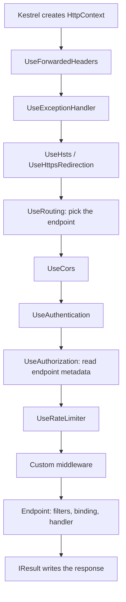

### 2.1 The Bidirectional Delegate Chain (`RequestDelegate`)

Everything in the pipeline is a function with this shape:

```csharp
public delegate Task RequestDelegate(HttpContext context);
```

A middleware receives the next delegate in the chain and returns a new delegate that wraps it. `Build()` composes the registrations from last to first, so the first middleware you register becomes the outermost layer. The request travels inward until something writes a response without calling `next` (a terminal middleware or the endpoint), then control unwinds outward through the code that runs after each `await next(context)`.

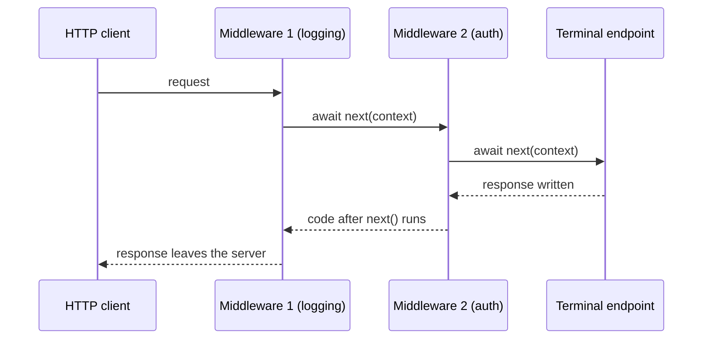

The smallest possible pipeline, written with inline delegates, shows the order of execution:

```csharp
var app = WebApplication.Create(args);

app.Use(async (context, next) =>
{
    Console.WriteLine("1 in");
    await next(context);
    Console.WriteLine("1 out");
});

app.Use(async (context, next) =>
{
    Console.WriteLine("2 in");
    if (context.Request.Path == "/short")
    {
        await context.Response.WriteAsync("short-circuited"); // no next(): the chain stops here
        return;
    }
    await next(context);
    Console.WriteLine("2 out");
});

app.Run(async context => await context.Response.WriteAsync("terminal")); // never calls next

app.Run();
```

A request to `/` prints `1 in, 2 in, 2 out, 1 out`. A request to `/short` prints `1 in, 2 in, 1 out`.

| API | What it adds | Calls `next`? |
| --- | --- | --- |
| `app.Use((context, next) => ...)` | A middleware layer | Usually, yes |
| `app.Run(context => ...)` | A terminal delegate | No, nothing after it runs |
| `app.Map("/path", branch => ...)` | A branch for a path prefix | The branch has its own chain |
| `app.UseWhen(predicate, branch => ...)` | A conditional branch that rejoins the main pipeline | Yes, after the branch |
| `app.MapGet(...)` | An endpoint, not a middleware | Executed by the endpoint middleware |

### 2.2 Middleware Order in a Real Application

Order is behaviour. Every middleware sees only what the middleware before it has done. The table gives the order ASP.NET Core components expect, and why each sits where it does:

| Order | Middleware | Why it sits here |
| --- | --- | --- |
| 1 | `UseForwardedHeaders` | Everything after it must see the client's real scheme and IP. |
| 2 | `UseExceptionHandler` | It can only catch exceptions thrown by middleware registered after it. |
| 3 | `UseHsts`, `UseHttpsRedirection` | Redirect before doing any real work. |
| 4 | `UseStaticFiles` or `MapStaticAssets` | Serve files without paying for routing, auth or the endpoint. |
| 5 | `UseRouting` | Chooses the endpoint and stores it on `HttpContext`. Added automatically by `WebApplication` if you do not call it. |
| 6 | `UseCors` | Must run after routing (to read per-endpoint CORS policies) and before auth (so preflight requests succeed). |
| 7 | `UseAuthentication` | Turns a token or cookie into `HttpContext.User`. |
| 8 | `UseAuthorization` | Reads the chosen endpoint's `[Authorize]`/`RequireAuthorization` metadata and checks `User`. |
| 9 | `UseRateLimiter` | After routing so endpoint-specific limiters apply; after auth if limits are per user. |
| 10 | `UseOutputCache`, custom middleware | Need the user and the endpoint. |
| 11 | Endpoints (`Map...`) | Executed by the endpoint middleware, which `WebApplication` adds at the end. |

`WebApplication` inserts `UseRouting()` at the start and the endpoint middleware at the end when you do not call them yourself. Call `UseRouting()` explicitly only when middleware must run before routing, for example forwarded headers or static files.

A whole-system picture, in the order a production request passes through it:

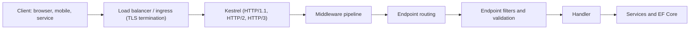

### 2.3 Writing Custom Middleware: Inline, Convention-Based and `IMiddleware`

There are three ways to write middleware. They differ in how the instance is created, which decides what you can inject.

| Style | Instance lifetime | Constructor can take | Per-request services via | Register with |
| --- | --- | --- | --- | --- |
| Inline `app.Use(...)` | One closure | Captured variables | `context.RequestServices` | `app.Use` |
| Convention-based class | **One per application** (created at `Build`) | Singletons only | Extra parameters on `InvokeAsync` | `app.UseMiddleware<T>()` |
| `IMiddleware` | **Resolved from DI per request** | Any lifetime it is registered with | Constructor | `builder.Services.AddScoped<T>()` + `app.UseMiddleware<T>()` |

Convention-based middleware is the cheapest because it is created once, and it is what the starter uses. This is [`Middleware/CorrelationIdMiddleware.cs`](src/LearnDotNet.Api/Middleware/CorrelationIdMiddleware.cs):

```csharp
namespace LearnDotNet.Api.Middleware;

public sealed class CorrelationIdMiddleware(RequestDelegate next, ILogger<CorrelationIdMiddleware> logger)
{
    public const string HeaderName = "X-Correlation-ID";

    public async Task InvokeAsync(HttpContext context)
    {
        var incoming = context.Request.Headers[HeaderName].ToString();
        var correlationId = IsAcceptable(incoming) ? incoming : Guid.NewGuid().ToString("N");

        context.TraceIdentifier = correlationId;

        context.Response.OnStarting(() =>
        {
            context.Response.Headers[HeaderName] = correlationId;
            return Task.CompletedTask;
        });

        using (logger.BeginScope(new Dictionary<string, object> { ["CorrelationId"] = correlationId }))
        {
            await next(context);
        }
    }

    private static bool IsAcceptable(string value) =>
        value.Length is > 0 and <= 64 && value.All(c => char.IsAsciiLetterOrDigit(c) || c is '-' or '_');
}
```

| Line / API | Role | What happens at runtime |
| :--- | :--- | :--- |
| Primary constructor `(RequestDelegate next, ILogger<...> logger)` | Dependencies | Resolved once when the pipeline is built. `ILogger<T>` is a singleton, so this is safe. |
| `Request.Headers[HeaderName].ToString()` | Read the header | `StringValues` converts to `""` when the header is missing, so there is no null check. |
| `IsAcceptable(...)` | Input validation | Rejects long or exotic values that could forge log lines or inflate header size. |
| `context.TraceIdentifier = ...` | Request id | Other components (and problem details) report this id. |
| `Response.OnStarting(...)` | Late header write | Runs right before the first byte of the body goes out. Setting headers after that throws `InvalidOperationException: Headers are read-only, response has already started`. |
| `logger.BeginScope(...)` | Log enrichment | Every log line written inside the `using` block carries `CorrelationId`. |
| `await next(context)` | Continue the chain | Everything after the `using` block would run on the way out. |

When the middleware needs a scoped service such as a `DbContext`, either add it as an `InvokeAsync` parameter (`public async Task InvokeAsync(HttpContext context, RoadmapDbContext db)`) or implement `IMiddleware`. This timing middleware uses `IMiddleware`:

```csharp
using System.Diagnostics;

public sealed class RequestTimingMiddleware(ILogger<RequestTimingMiddleware> logger) : IMiddleware
{
    public async Task InvokeAsync(HttpContext context, RequestDelegate next)
    {
        var start = Stopwatch.GetTimestamp();
        try
        {
            await next(context);
        }
        finally
        {
            // finally: also logs requests that threw, with the status set by the exception handler
            var elapsed = Stopwatch.GetElapsedTime(start);
            logger.LogInformation("HTTP {Method} {Path} responded {StatusCode} in {ElapsedMs:0.00} ms",
                context.Request.Method, context.Request.Path, context.Response.StatusCode, elapsed.TotalMilliseconds);
        }
    }
}

// Program.cs: IMiddleware must be registered, or UseMiddleware throws at startup
builder.Services.AddTransient<RequestTimingMiddleware>();
app.UseMiddleware<RequestTimingMiddleware>();
```

`Stopwatch.GetTimestamp()` with `Stopwatch.GetElapsedTime(start)` measures without allocating a `Stopwatch` object. For real request metrics, prefer the built-in `http.server.request.duration` histogram that ASP.NET Core already emits (Stage 6).

### 2.4 Endpoint Routing: Templates, Constraints and Precedence

Routing maps a request to an **endpoint**: a `RequestDelegate` plus metadata (route pattern, HTTP methods, authorization policies, OpenAPI information). Routing happens in two steps. The routing middleware matches the URL and stores the endpoint on the context (`context.GetEndpoint()`); the endpoint middleware at the end of the pipeline executes it. Everything in between, such as authorization and CORS, can read the chosen endpoint's metadata.

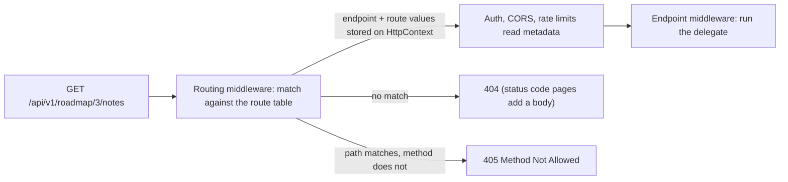

Route templates and constraints:

| Template | Matches | Does not match |
| --- | --- | --- |
| `/stages/{number:int}` | `/stages/3` | `/stages/three` (no endpoint, 404) |
| `/stages/{number:int:range(1,7)}` | `/stages/7` | `/stages/8` |
| `/files/{*path}` | `/files/a/b/c.txt` (catch-all) | |
| `/notes/{id:guid}` | `/notes/1f0c...` | `/notes/42` |
| `/search/{term?}` | `/search` and `/search/kestrel` | |
| `/slug/{name:regex(^[a-z0-9-]+$)}` | `/slug/learn-dot-net` | `/slug/Learn_Dot` |

Constraints decide which endpoint matches; they are not input validation. A failed constraint produces a 404, not a 400 with a useful message, so use them to disambiguate routes and validate business rules in the handler or with `AddValidation()`. The starter's test `Non_numeric_stage_does_not_match_the_int_route_constraint` shows the 404.

When two templates match the same URL, the more specific one wins: literal segments beat parameters, constrained parameters beat unconstrained ones, and parameters beat catch-alls. Two endpoints of equal precedence for the same URL and method throw `AmbiguousMatchException` at request time, not at startup, so cover routes with tests.

Generate links from route names instead of concatenating strings:

```csharp
app.MapGet("/api/v1/roadmap/{stageNumber:int}", GetOne).WithName("GetStageByNumber");

app.MapPost("/api/v1/roadmap", (LinkGenerator links, HttpContext http) =>
{
    var url = links.GetUriByName(http, "GetStageByNumber", new { stageNumber = 3 });
    return TypedResults.Ok(new { url }); // "http://localhost:5080/api/v1/roadmap/3"
});
```

### 2.5 Minimal API Handlers and Parameter Binding

A minimal API handler is any delegate. At startup ASP.NET Core inspects the delegate's parameters and generates the code that reads each one from the request. With Native AOT or `<EnableRequestDelegateGenerator>true</EnableRequestDelegateGenerator>`, a source generator writes that code at compile time instead of building it at runtime.

Where each parameter comes from, when you do not say explicitly:

| Parameter | Source | Explicit attribute |
| --- | --- | --- |
| Name matches a route parameter (`int stageNumber`) | Route values | `[FromRoute]` |
| Simple type (`int`, `string`, `Guid`, enums, anything with `TryParse`) not in the route | Query string | `[FromQuery]` |
| Complex type (a record or class) on POST/PUT/PATCH | JSON body (only one body parameter is allowed) | `[FromBody]` |
| Type registered in DI (`IRoadmapService`) | Service container | `[FromServices]`, `[FromKeyedServices("key")]` |
| `HttpContext`, `HttpRequest`, `HttpResponse`, `ClaimsPrincipal`, `CancellationToken` | Special: the current request | none needed |
| `IFormFile`, `IFormCollection` | Form body | `[FromForm]` |
| A header | Must be explicit | `[FromHeader(Name = "X-Tenant")]` |
| A group of the above | Properties of a class | `[AsParameters]` |

The starter's handlers are static methods, which keeps them testable and lets the `Results<...>` return type document every status code:

```csharp
internal static async Task<Results<Created<StageNote>, ProblemHttpResult>> AddNote(
    int stageNumber, NewNote note, IRoadmapService service, CancellationToken ct)
{
    var result = await service.AddNoteAsync(stageNumber, note.Text, ct);
    return result switch
    {
        NoteResult.Created created =>
            TypedResults.Created($"/api/v1/roadmap/{stageNumber}/notes/{created.Note.Id}", created.Note),
        NoteResult.LimitReached limit => TypedResults.Problem(
            title: "Note limit reached",
            detail: $"Stage {stageNumber} already has {limit.Limit} notes.",
            statusCode: StatusCodes.Status409Conflict),
        _ => StageNotFound(stageNumber),
    };
}
```

`stageNumber` comes from the route, `note` from the JSON body, `service` from DI and `ct` is `HttpContext.RequestAborted`, which fires when the client disconnects. Passing it to EF Core cancels the SQL command instead of finishing work nobody will read.

A handler that creates a resource with an inline lambda and endpoint metadata:

```csharp
public record CreateProductRequest(string Name, decimal Price);
public record ProductResponse(Guid Id, string Name, decimal Price, DateTimeOffset CreatedAt);

var products = app.MapGroup("/api/v1/products").WithTags("Products");

products.MapPost("/", async (CreateProductRequest request, IProductRepository repo, TimeProvider clock, CancellationToken ct) =>
{
    var product = new ProductResponse(Guid.NewGuid(), request.Name, request.Price, clock.GetUtcNow());
    await repo.SaveAsync(product, ct);
    return TypedResults.Created($"/api/v1/products/{product.Id}", product);
})
.WithName("CreateProduct")
.WithSummary("Create a product");

public interface IProductRepository
{
    Task SaveAsync(ProductResponse product, CancellationToken ct);
}
```

#### Custom binding with `TryParse` and `BindAsync`

A type can take part in binding without a custom model binder. A static `TryParse(string, out T)` makes it bindable from a single route or query value. A static `BindAsync(HttpContext)` lets it read whatever it needs from the request:

```csharp
public readonly record struct Paging(int Page, int Size)
{
    // Reads ?page=2&size=50, applies defaults and clamps to safe bounds.
    public static ValueTask<Paging> BindAsync(HttpContext context)
    {
        var query = context.Request.Query;
        var page = int.TryParse(query["page"], out var p) ? Math.Max(1, p) : 1;
        var size = int.TryParse(query["size"], out var s) ? Math.Clamp(s, 1, 100) : 20;
        return ValueTask.FromResult(new Paging(page, size));
    }
}

public readonly record struct StageCode(int Number)
{
    // Binds "S3" from /stages/by-code/S3
    public static bool TryParse(string? value, out StageCode code)
    {
        if (value is ['S', .. var digits] && int.TryParse(digits, out var n) && n > 0)
        {
            code = new StageCode(n);
            return true;
        }

        code = default;
        return false;
    }
}

app.MapGet("/api/items", (Paging paging) => TypedResults.Ok(paging));
app.MapGet("/stages/by-code/{code}", (StageCode code) => TypedResults.Ok(code.Number));
```

`BindAsync` returns synchronously here, so it uses `ValueTask.FromResult` instead of an `async` method with no `await` (which the compiler warns about). When `TryParse` returns false for a route value, the framework answers 400 before the handler runs.

### 2.6 Results: `IResult`, `TypedResults` and `Results<T1, T2>`

A handler can return a plain object (serialized as JSON with status 200), a `string` (written as `text/plain`), or an `IResult` that controls the status, headers and body. There are two factories:

| Factory | Return type | OpenAPI knows the response types? | Unit-testable without HTTP? |
| --- | --- | --- | --- |
| `Results.Ok(x)` | `IResult` | No, add `.Produces<T>(200)` by hand | You have to cast to inspect it |
| `TypedResults.Ok(x)` | `Ok<T>` | Yes, from the return type | Yes: `Assert.IsType<Ok<RoadmapStage>>(result)` |

When a handler can return different results, declare the union with `Results<T1, ..., Tn>`. The compiler then rejects any branch that returns something outside the list, and the OpenAPI document lists each status:

```csharp
internal static async Task<Results<Ok<RoadmapStage>, ProblemHttpResult>> GetOne(
    int stageNumber, IRoadmapService service, CancellationToken ct)
{
    var stage = await service.GetStageAsync(stageNumber, ct);
    return stage is null ? StageNotFound(stageNumber) : TypedResults.Ok(stage);
}
```

Because the handler is a plain static method, a unit test can call it directly:

```csharp
var result = await RoadmapEndpoints.GetOne(99, fakeService, CancellationToken.None);
var problem = Assert.IsType<ProblemHttpResult>(result.Result);
Assert.Equal(404, problem.StatusCode);
```

Other results you will use: `TypedResults.NoContent()`, `Created(uri, value)`, `Accepted(uri)`, `ValidationProblem(errors)`, `Conflict()`, `File(bytes, contentType)`, `Stream(...)`, `Redirect(url)` and, new in .NET 10, `TypedResults.ServerSentEvents(asyncEnumerable)` for server-sent event streams.

JSON serialization uses `System.Text.Json` with web defaults (camelCase names, case-insensitive reads). Change them once:

```csharp
builder.Services.ConfigureHttpJsonOptions(options =>
{
    options.SerializerOptions.Converters.Add(new System.Text.Json.Serialization.JsonStringEnumConverter());
});
```

### 2.7 Route Groups and Endpoint Filters (`IEndpointFilter`)

`MapGroup` creates a prefix that endpoints inherit along with any metadata, filters, authorization or rate limiting you attach to the group. The starter maps its feature this way:

```csharp
public static RouteGroupBuilder MapRoadmapEndpoints(this IEndpointRouteBuilder routes)
{
    var group = routes.MapGroup("/api/v1/roadmap").WithTags("Roadmap");

    group.MapGet("/", GetAll).WithName("GetAllStages");
    group.MapGet("/{stageNumber:int}", GetOne).WithName("GetStageByNumber");
    group.MapPut("/{stageNumber:int}/completion", SetCompletion).WithName("SetStageCompletion");
    group.MapGet("/{stageNumber:int}/notes", GetNotes).WithName("GetStageNotes");
    group.MapPost("/{stageNumber:int}/notes", AddNote).WithName("AddStageNote");
    group.MapGet("/progress", GetProgress).WithName("GetRoadmapProgress");
    return group;
}
```

Endpoint filters are middleware for one endpoint or group. They run after routing and binding, so unlike middleware they can see the bound arguments, and they can replace the result:

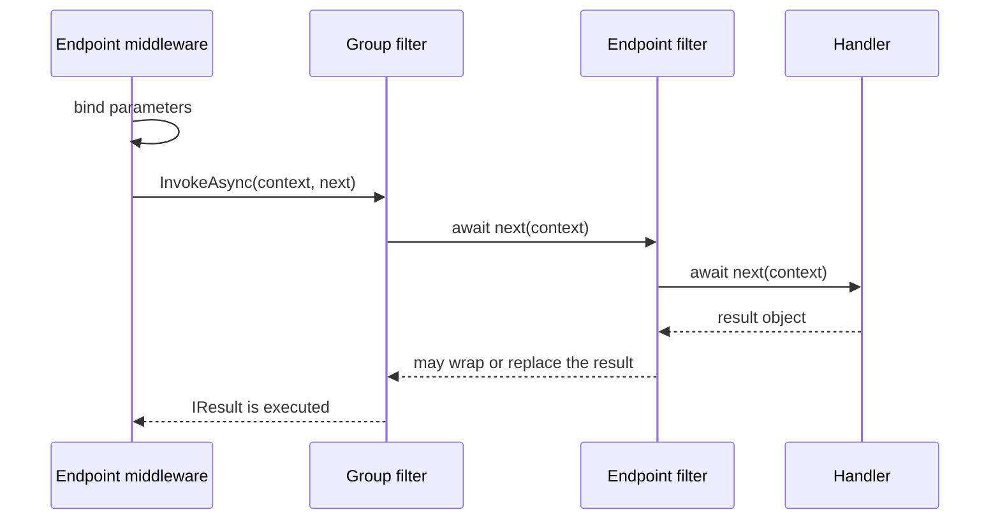

A filter that rejects requests whose `If-Match` header is missing on updates:

```csharp
public sealed class RequireIfMatchFilter : IEndpointFilter
{
    public async ValueTask<object?> InvokeAsync(EndpointFilterInvocationContext context, EndpointFilterDelegate next)
    {
        if (context.HttpContext.Request.Headers.IfMatch.Count == 0)
        {
            return TypedResults.Problem(
                title: "Precondition required",
                detail: "Send the resource's ETag in If-Match to update it.",
                statusCode: StatusCodes.Status428PreconditionRequired);
        }

        return await next(context);
    }
}

group.MapPut("/{stageNumber:int}/completion", SetCompletion)
     .AddEndpointFilter<RequireIfMatchFilter>();
```

Filters execute in the order you add them, group filters before endpoint filters. `context.Arguments` holds the bound parameters by position, and `context.GetArgument<T>(index)` reads one with a type check.

### 2.8 Input Validation: .NET 10 `AddValidation()` and the Filter It Replaces

Before .NET 10, minimal APIs did not run data annotations, so teams wrote a filter like this one, which still works and is useful on .NET 8 and 9:

```csharp
using System.ComponentModel.DataAnnotations;

public sealed class ValidationFilter<T> : IEndpointFilter where T : class
{
    public async ValueTask<object?> InvokeAsync(EndpointFilterInvocationContext context, EndpointFilterDelegate next)
    {
        var argument = context.Arguments.OfType<T>().FirstOrDefault();
        if (argument is null)
        {
            return TypedResults.Problem("Missing request body.", statusCode: StatusCodes.Status400BadRequest);
        }

        var results = new List<ValidationResult>();
        if (!Validator.TryValidateObject(argument, new ValidationContext(argument), results, validateAllProperties: true))
        {
            var errors = results
                .SelectMany(r => r.MemberNames.DefaultIfEmpty(string.Empty), (r, member) => (member, r.ErrorMessage ?? "Invalid value."))
                .GroupBy(x => x.member)
                .ToDictionary(g => g.Key, g => g.Select(x => x.Item2).ToArray());
            return TypedResults.ValidationProblem(errors);
        }

        return await next(context);
    }
}

// Attributes need the "property:" target on a positional record, because
// Validator.TryValidateObject looks at properties, not constructor parameters.
public record CreateProductRequest(
    [property: Required, StringLength(100)] string Name,
    [property: Range(0.01, 100000.0)] decimal Price);

products.MapPost("/", CreateProduct).AddEndpointFilter<ValidationFilter<CreateProductRequest>>();
```

The `property:` detail is a classic bug: `[Required] string Name` on a positional record applies the attribute to the constructor parameter, the reflection-based validator never sees it, and every request passes.

On .NET 10 one line replaces the filter for every endpoint:

```csharp
builder.Services.AddValidation();

public record NewNote([Required, StringLength(280, MinimumLength = 3)] string Text);
```

A source generator finds the types used as handler parameters and emits validation code for their attributes, including attributes on record constructor parameters, nested objects and collections, and on route or query parameters themselves (`[Range(1, 7)] int stageNumber`). Failures produce a `400` with an RFC 9457 validation problem:

```json
{
  "type": "https://tools.ietf.org/html/rfc9110#section-15.5.1",
  "title": "One or more validation errors occurred.",
  "status": 400,
  "errors": { "Text": ["The field Text must be a string with a minimum length of 3 and a maximum length of 280."] }
}
```

| Approach | Runs where | Covers | Use it when |
| --- | --- | --- | --- |
| `AddValidation()` (.NET 10) | Before the handler, generated code | Data annotations, `IValidatableObject` | Default for new code |
| Hand-written `ValidationFilter<T>` | Endpoint filter, reflection | Data annotations | Still on .NET 8/9 |
| FluentValidation (third party) | Filter or handler | Rules written in code, async rules | Complex cross-field or database-backed rules |
| Checks in the handler or service | Business logic | Anything | Rules that need state, such as the note limit (409) |

Validation answers "is this request well formed"; the service answers "is it allowed now". The starter's note limit is a business rule, so the service returns `NoteResult.LimitReached` and the endpoint maps it to 409.

### 2.9 Error Handling: `IExceptionHandler` and Problem Details (RFC 9457)

Every error response from an API should have the same machine-readable shape. RFC 9457 (which replaced RFC 7807) defines it: `type`, `title`, `status`, `detail`, `instance`, plus extension members. ASP.NET Core implements it through `IProblemDetailsService`, which `AddProblemDetails()` registers and which the exception handler, status code pages and validation all use.

Before .NET 8, global error handling meant a custom middleware with try/catch. .NET 8 added `IExceptionHandler`: you register one or more handlers, and `UseExceptionHandler()` calls them in registration order until one returns `true`. This is the starter's [`Errors/GlobalExceptionHandler.cs`](src/LearnDotNet.Api/Errors/GlobalExceptionHandler.cs):

```csharp
using Microsoft.AspNetCore.Diagnostics;

namespace LearnDotNet.Api.Errors;

public sealed class GlobalExceptionHandler(
    IProblemDetailsService problemDetails,
    ILogger<GlobalExceptionHandler> logger) : IExceptionHandler
{
    public async ValueTask<bool> TryHandleAsync(HttpContext httpContext, Exception exception, CancellationToken cancellationToken)
    {
        var (status, title) = exception switch
        {
            BadHttpRequestException bad => (bad.StatusCode, "The request was malformed."),
            _ => (StatusCodes.Status500InternalServerError, "An unexpected error occurred."),
        };

        if (status >= StatusCodes.Status500InternalServerError)
        {
            logger.LogError(exception, "Unhandled exception for {Method} {Path}", httpContext.Request.Method, httpContext.Request.Path);
        }

        httpContext.Response.StatusCode = status;

        return await problemDetails.TryWriteAsync(new ProblemDetailsContext
        {
            HttpContext = httpContext,
            Exception = exception,
            ProblemDetails =
            {
                Status = status,
                Title = title,
                Extensions = { ["traceId"] = httpContext.TraceIdentifier },
            },
        });
    }
}
```

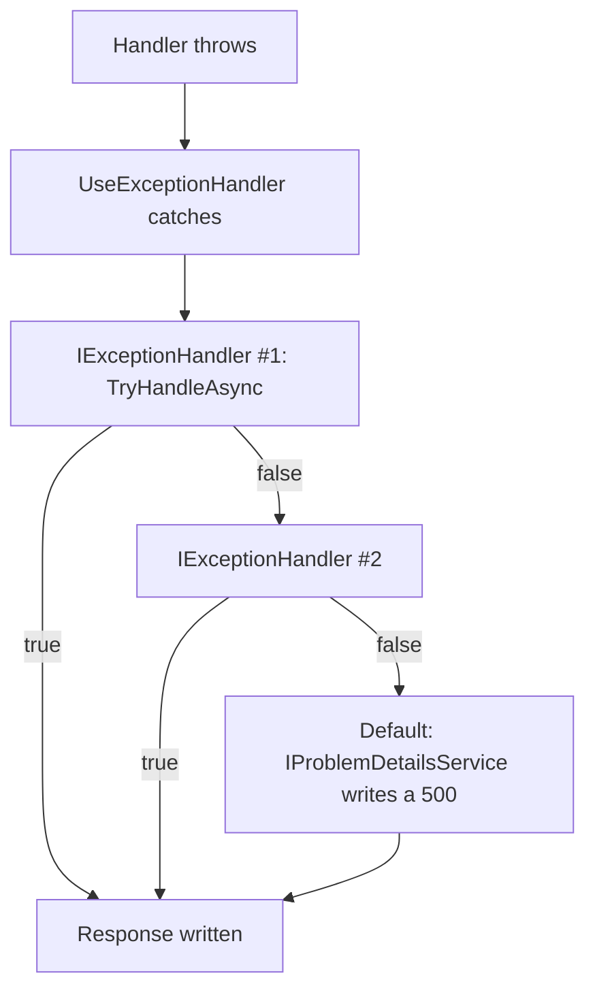

Design decisions in that handler:

- **The exception message is not sent to the client.** Messages can contain SQL, connection strings or file paths. The test `Unhandled_exception_becomes_a_500_problem_without_the_message` puts a fake password in an exception and asserts it never reaches the body.
- **Only 5xx errors are logged as errors.** A malformed request is the client's problem; logging it at error level floods alerts.
- **`traceId` is included**, so a user can quote it and support can find the stack trace.
- **Domain errors are not exceptions.** "Stage not found" and "limit reached" are expected outcomes, returned as results (`ProblemHttpResult`) rather than thrown. Exceptions are for bugs and infrastructure failures, and they are slow to throw.

A common anti-pattern maps exception types to status codes globally (`ArgumentException` to 400, `KeyNotFoundException` to 404). It looks tidy, but an `ArgumentException` thrown by a bug deep in a library then becomes a misleading 400, and the bug is hidden from error dashboards. Map only exception types you own and throw deliberately, or better, return results.

Since .NET 9, `UseExceptionHandler(new ExceptionHandlerOptions { StatusCodeSelector = ex => ... })` chooses a status code without writing a handler, and `AddProblemDetails(o => o.CustomizeProblemDetails = ctx => ...)` adds fields (such as a correlation id) to every problem response in one place.

### 2.10 Minimal APIs vs MVC Controllers

Both are first-class and can live in the same application. They share routing, model binding concepts, authorization and OpenAPI.

| Concern | Minimal APIs | MVC controllers (`[ApiController]`) |
| --- | --- | --- |
| Shape | Delegates or static methods mapped in code | Classes with action methods and attributes |
| Discovery | Explicit `Map...` calls | `MapControllers()` scans assemblies for controllers |
| Cross-cutting code | Endpoint filters, route groups | Action, resource, result and exception filters |
| Validation | `AddValidation()` (.NET 10) | Automatic with `[ApiController]` (`ModelState`) |
| Native AOT | Supported | Not supported |
| Per-request cost | Lower: no controller activation, fewer filter stages | Higher, though rarely the bottleneck |
| Server-rendered HTML | Razor Components or Razor Pages instead | MVC views |
| Best fit | New HTTP APIs, microservices, AOT | Existing MVC codebases, teams invested in action filters and conventions |

```csharp
// The same endpoint as a controller, for comparison
[ApiController]
[Route("api/v1/roadmap")]
public sealed class RoadmapController(IRoadmapService service) : ControllerBase
{
    [HttpGet("{stageNumber:int}")]
    public async Task<ActionResult<RoadmapStage>> GetOne(int stageNumber, CancellationToken ct)
    {
        var stage = await service.GetStageAsync(stageNumber, ct);
        return stage is null ? NotFound() : stage;
    }
}

// Program.cs
builder.Services.AddControllers();
app.MapControllers();
```

Choose by team and deployment target, not by benchmark: in a real service the database call dominates the cost of either.

### 2.11 Pitfalls

| Pitfall | Symptom | Fix |
| --- | --- | --- |
| `UseExceptionHandler()` registered after the middleware that throws | Raw 500 with an empty body, or the developer exception page | Register it first (after forwarded headers). |
| Writing headers after the body started | `InvalidOperationException: Headers are read-only, response has already started.` | Set headers before `await next()`, or in `Response.OnStarting`. |
| `UseAuthorization()` before `UseRouting()` when routing is explicit | `[Authorize]` and `RequireAuthorization` are silently ignored | Keep the order routing, authentication, authorization. |
| Injecting a scoped service into a convention middleware constructor | `InvalidOperationException: Cannot resolve scoped service ... from root provider.` | Take it as an `InvokeAsync` parameter, or use `IMiddleware`. |
| `IMiddleware` not registered in DI | `InvalidOperationException: No service for type 'RequestTimingMiddleware' has been registered.` | `builder.Services.AddTransient<RequestTimingMiddleware>()`. |
| Data annotations on positional record parameters with a reflection validator | Invalid requests pass validation | `[property: Required]`, or `AddValidation()` on .NET 10. |
| Two body parameters on one handler | Startup error: `Failure to infer one or more parameters` / only one body allowed | Wrap them in one request record. |
| Route constraint used as validation | Client gets a bare 404 for `/stages/abc` and cannot tell why | Use constraints to pick routes; validate in the handler or with `AddValidation()`. |
| Not passing `CancellationToken` | Abandoned requests keep running database queries | Add `CancellationToken ct` to handlers and pass it down. |
| Synchronous I/O (`File.ReadAllText`, `Stream.Read`) in handlers | Thread-pool starvation; Kestrel throws `Synchronous operations are disallowed` for sync body reads | Use the async APIs (`ReadAllTextAsync`, `ReadFromJsonAsync`). |
| Exception messages in error responses | Stack traces, SQL or secrets visible to clients | Generic titles plus a `traceId`; details only in logs. |
| Fat handlers mixing SQL, business rules and HTTP formatting | Untestable endpoints, duplicated rules | Handlers translate HTTP to service calls; services hold rules (vertical slices or a service layer). |

### 2.12 Best Practices

- Register middleware in the order from 2.2: most pipeline bugs are ordering bugs.
- Prefer convention-based middleware with singleton dependencies: it is created once and costs least per request.
- Return `TypedResults` and declare `Results<...>`: the compiler checks every branch and OpenAPI documents every status.
- Model expected failures as results, not exceptions: exceptions are slow and pollute error metrics.
- Use one problem details format for every error: clients write one error parser.
- Never echo exception messages: they are an information-disclosure risk.
- Keep handlers thin and static: they become unit-testable without a web host.
- Accept `CancellationToken` in every I/O-bound handler: cancelled requests stop consuming database time.
- Group routes with `MapGroup` and attach shared policy there: one place to change auth, tags or rate limits for a feature.
- Use `AddValidation()` on .NET 10 for shape rules and the service layer for state-dependent rules: each rule lives in exactly one layer.

### 2.13 Hands-on Exercise

Add an ETag to stage responses and require it for updates.

1. In `GetOne`, compute an ETag from the stage (for example `"\"{stageNumber}-{completed}\""`) and set `ETag` on the response. Return `304 Not Modified` when the request's `If-None-Match` equals it.
2. Attach the `RequireIfMatchFilter` from 2.7 to the `PUT .../completion` endpoint, and return `412 Precondition Failed` when `If-Match` does not equal the current ETag.
3. Write two integration tests in [`tests/LearnDotNet.Tests/RoadmapApiTests.cs`](tests/LearnDotNet.Tests/RoadmapApiTests.cs): a `PUT` without `If-Match` returns 428, and a `PUT` with a stale ETag returns 412.

Expected exchange:

```text
GET /api/v1/roadmap/4           -> 200, ETag: "4-False"
GET /api/v1/roadmap/4  If-None-Match: "4-False"   -> 304
PUT /api/v1/roadmap/4/completion (no If-Match)    -> 428
PUT /api/v1/roadmap/4/completion If-Match: "4-True" -> 412
PUT /api/v1/roadmap/4/completion If-Match: "4-False" -> 200
```

The pieces you need are all in this stage: response headers (2.3), filters (2.7) and `TypedResults.Problem` (2.6). The existing endpoint code to extend is in [`Endpoints/RoadmapEndpoints.cs`](src/LearnDotNet.Api/Endpoints/RoadmapEndpoints.cs).

[Back to top ⤴️](#-table-of-contents)

---

## 3. Stage 3: Dependency Injection, Options & EF Core Data Access

This stage builds the layer behind the endpoints: the dependency injection container that creates your services, the options pattern that turns configuration into validated objects, and EF Core, which maps C# classes to database tables. It assumes Stages 1 and 2. Afterwards you can choose correct service lifetimes, catch configuration mistakes at startup, model and query a relational database, evolve its schema with migrations and handle concurrent updates.

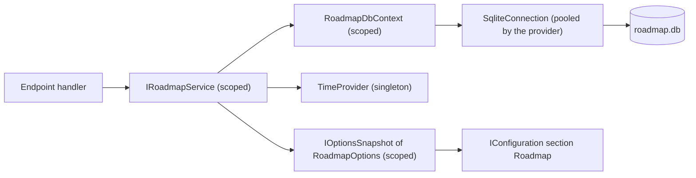

### 3.1 How the DI Container Works

ASP.NET Core is built around constructor injection. You describe services in an `IServiceCollection` (a list of `ServiceDescriptor` entries: service type, implementation, lifetime), and `builder.Build()` turns that list into an `IServiceProvider`. When something asks for a service, the provider looks up the descriptor, recursively resolves the constructor parameters, and caches the instance according to its lifetime.

```csharp
builder.Services.AddSingleton(TimeProvider.System);                 // instance
builder.Services.AddScoped<IRoadmapService, RoadmapService>();      // interface -> implementation
builder.Services.AddTransient<RequestTimingMiddleware>();           // concrete type
builder.Services.AddSingleton<ISlugger>(sp =>                       // factory
    new Slugger(sp.GetRequiredService<IOptions<SluggerOptions>>().Value));
```

The provider compiles a "call site" for each service the first time it is resolved and reuses it, so resolution after warm-up is a few dictionary lookups and constructor calls. There is no attribute scanning and no property injection: what a class needs is exactly its constructor's parameter list, which makes dependencies explicit and the class easy to construct in a test.

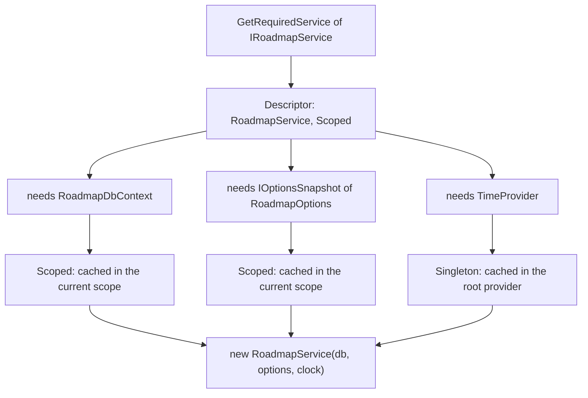

Rules the container follows that you should know:

| Rule | Consequence |
| --- | --- |
| The last registration of a service type wins for `GetService<T>()` | Registering twice silently overrides. Use `TryAdd*` in libraries so the app can override. |
| `IEnumerable<T>` resolves every registration of `T` | This is how multiple `IExceptionHandler`s or health checks are collected. |
| With several constructors, the one with the most resolvable parameters is chosen | Keep one public constructor to avoid surprises. |
| The container disposes what it creates | Singletons when the app stops, scoped services when the scope ends. It never disposes instances you passed in with `AddSingleton(instance)`. |
| Transient `IDisposable` services are tracked by the scope that resolved them | Resolving them from the root provider keeps every instance alive until shutdown, a slow memory leak. |
| `Build()` freezes the collection | Registering after `Build()` throws `InvalidOperationException: The service collection cannot be modified because it is read-only.` |

### 3.2 Service Lifetimes and the Captive Dependency Problem

| Lifetime | One instance per | Use for | Example |
| --- | --- | --- | --- |
| **Transient** (`AddTransient`) | Resolution | Lightweight, stateless helpers | Mappers, `IMiddleware` implementations |
| **Scoped** (`AddScoped`) | Scope; in ASP.NET Core, one HTTP request | Anything that holds per-request state or a unit of work | `DbContext`, repositories, `RoadmapService` |
| **Singleton** (`AddSingleton`) | Application | Thread-safe, stateless or shared-cache services | `TimeProvider`, `HttpClient` handlers via `IHttpClientFactory`, in-memory caches |

A service must never depend on a service with a **shorter** lifetime. If a singleton takes a scoped `DbContext` in its constructor, the first context ever created is captured and reused by every request on every thread, forever. `DbContext` is not thread-safe, its change tracker grows without bound, and data from one user's request leaks into another's. This is the **captive dependency** problem.

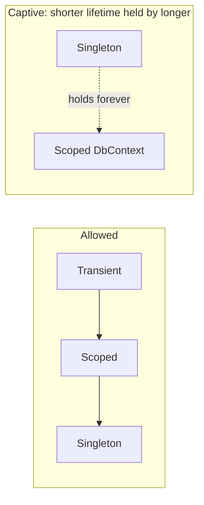

ASP.NET Core catches this in the Development environment, because `CreateBuilder` turns on `ValidateScopes` and `ValidateOnBuild` there. The app fails at startup with:

```text
System.AggregateException: Some services are not able to be constructed
 (Error while validating the service descriptor 'ServiceType: ICache Lifetime: Singleton ImplementationType: StageCache':
  Cannot consume scoped service 'RoadmapDbContext' from singleton 'ICache'.)
```

Production does not validate (it costs startup time), so a captive dependency introduced in a configuration that only runs in production will not fail fast. Turn validation on everywhere if your startup budget allows it:

```csharp
builder.Host.UseDefaultServiceProvider(options =>
{
    options.ValidateScopes = true;
    options.ValidateOnBuild = true;
});
```

### 3.3 Scopes Outside a Request: `IServiceScopeFactory`

Background services are singletons, and there is no HTTP request around them, so they must create their own scope to use scoped services. Create one scope per unit of work, not one for the life of the worker; otherwise the `DbContext` inside it becomes captive again.

```csharp
using LearnDotNet.Api.Data;
using Microsoft.EntityFrameworkCore;

public sealed class StaleNoteCleaner(IServiceScopeFactory scopes, TimeProvider clock, ILogger<StaleNoteCleaner> logger)
    : BackgroundService
{
    protected override async Task ExecuteAsync(CancellationToken stoppingToken)
    {
        using var timer = new PeriodicTimer(TimeSpan.FromHours(1), clock);
        while (await timer.WaitForNextTickAsync(stoppingToken))
        {
            // A fresh scope per iteration: a fresh DbContext and change tracker each time.
            await using var scope = scopes.CreateAsyncScope();
            var db = scope.ServiceProvider.GetRequiredService<RoadmapDbContext>();

            var cutoff = clock.GetUtcNow().AddDays(-90);
            var deleted = await db.Notes.Where(n => n.CreatedAt < cutoff).ExecuteDeleteAsync(stoppingToken);
            logger.LogInformation("Deleted {Count} notes older than {Cutoff}", deleted, cutoff);
        }
    }
}

// Program.cs
builder.Services.AddHostedService<StaleNoteCleaner>();
```

`CreateAsyncScope()` returns an `AsyncServiceScope`, whose `DisposeAsync` correctly disposes services that implement only `IAsyncDisposable`. The starter uses the same pattern in `Program.cs` to create the database at startup, where no request scope exists either.

### 3.4 Keyed Services (.NET 8+)

Before .NET 8, choosing between several implementations of one interface meant injecting `IEnumerable<T>` and filtering, or writing a factory. Keyed services register each implementation under a key and resolve by key:

```csharp
public interface INotificationSender
{
    Task SendAsync(string recipient, string message, CancellationToken ct);
}

public sealed class SmsSender : INotificationSender
{
    public Task SendAsync(string recipient, string message, CancellationToken ct) => Task.CompletedTask;
}

public sealed class EmailSender : INotificationSender
{
    public Task SendAsync(string recipient, string message, CancellationToken ct) => Task.CompletedTask;
}

// Registration
builder.Services.AddKeyedSingleton<INotificationSender, SmsSender>("sms");
builder.Services.AddKeyedSingleton<INotificationSender, EmailSender>("email");

// A key known at compile time: inject it directly
public sealed class PasswordResetService([FromKeyedServices("email")] INotificationSender sender)
{
    public Task SendAsync(string to, CancellationToken ct) => sender.SendAsync(to, "Your reset link", ct);
}

// A key chosen at runtime: resolve it from the provider
app.MapPost("/notify/{channel}", async (string channel, NotifyRequest body, IServiceProvider sp, CancellationToken ct) =>
{
    var sender = sp.GetKeyedService<INotificationSender>(channel);
    if (sender is null)
    {
        return Results.Problem($"Unknown channel '{channel}'.", statusCode: StatusCodes.Status400BadRequest);
    }

    await sender.SendAsync(body.Recipient, body.Message, ct);
    return Results.Accepted();
});

public record NotifyRequest(string Recipient, string Message);
```

| Approach | Good for | Drawback |
| --- | --- | --- |
| Keyed services | A fixed set of strategies selected by a name or enum | Keys are stringly typed; use constants or an enum. |
| `IEnumerable<T>` plus a `Name` property | Plugins discovered at startup | Every implementation is constructed on each resolution. |
| A factory interface (`ISenderFactory.Create(channel)`) | Construction logic that needs runtime arguments | More code to write and register. |

Injecting every keyed implementation into one handler and branching on the key (as some samples do) constructs services you do not use and hides the real dependency; resolve the one you need.

### 3.5 The Options Pattern: Typed, Validated Configuration

Reading `builder.Configuration["Roadmap:MaxNotesPerStage"]` in many places scatters string keys and parses values repeatedly. The options pattern binds a configuration section to a class once, validates it, and injects it.

The starter's [`Options/RoadmapOptions.cs`](src/LearnDotNet.Api/Options/RoadmapOptions.cs):

```csharp
using System.ComponentModel.DataAnnotations;

namespace LearnDotNet.Api.Options;

public sealed class RoadmapOptions
{
    public const string SectionName = "Roadmap";

    [Required, MinLength(1)]
    public string Title { get; set; } = string.Empty;

    [Range(1, 100)]
    public int MaxNotesPerStage { get; set; } = 20;
}
```

And its registration:

```csharp
builder.Services.AddOptions<RoadmapOptions>()
    .Bind(builder.Configuration.GetSection(RoadmapOptions.SectionName))
    .ValidateDataAnnotations()
    .ValidateOnStart();
```

Without `ValidateOnStart()`, validation runs lazily the first time someone reads `.Value`, which means a typo in a Kubernetes manifest surfaces as a 500 on some request hours later. With it, the host refuses to start and the deployment fails its readiness check immediately. The test `Invalid_options_stop_the_host_at_startup` sets `Roadmap:MaxNotesPerStage` to `0` and asserts an `OptionsValidationException`.

Three interfaces read options, and they differ in when they see changes:

| Interface | Lifetime | Sees `appsettings.json` edits | Use in |
| --- | --- | --- | --- |
| `IOptions<T>` | Singleton | No: computed once | Singletons; values that never change at runtime |
| `IOptionsSnapshot<T>` | Scoped | Yes, at the start of each request | Scoped services and handlers (the starter's `RoadmapService`) |
| `IOptionsMonitor<T>` | Singleton | Yes, immediately, with `OnChange` callbacks | Singletons that must react to changes |

Injecting `IOptionsSnapshot<T>` into a singleton is itself a captive dependency and is caught by scope validation.

Validation beyond attributes:

```csharp
builder.Services.AddOptions<SmtpOptions>()
    .BindConfiguration("Smtp")                       // shorthand for Bind(GetSection("Smtp"))
    .ValidateDataAnnotations()
    .Validate(o => o.Port is 25 or 465 or 587, "Smtp:Port must be 25, 465 or 587.")
    .ValidateOnStart();

public sealed class SmtpOptions
{
    [Required] public string Host { get; set; } = "";
    public int Port { get; set; } = 587;
}
```

For trimming and Native AOT, data annotation validation uses reflection. The `[OptionsValidator]` source generator writes the same checks at compile time:

```csharp
[OptionsValidator]
public sealed partial class RoadmapOptionsValidator : IValidateOptions<RoadmapOptions>;

builder.Services.AddSingleton<IValidateOptions<RoadmapOptions>, RoadmapOptionsValidator>();
```

Named options (`Configure<T>("name", ...)` and `IOptionsMonitor<T>.Get("name")`) give several configurations of one type, for example one `HttpClientSettings` per downstream service.

### 3.6 EF Core: `DbContext`, Entities and Relationships

EF Core maps classes to tables and LINQ queries to SQL. A `DbContext` is a unit of work: it holds a database connection while it needs one, a change tracker that remembers the entities it loaded, and the model (the mapping, built once per context type and cached).

The starter's model has stages and notes, one-to-many:

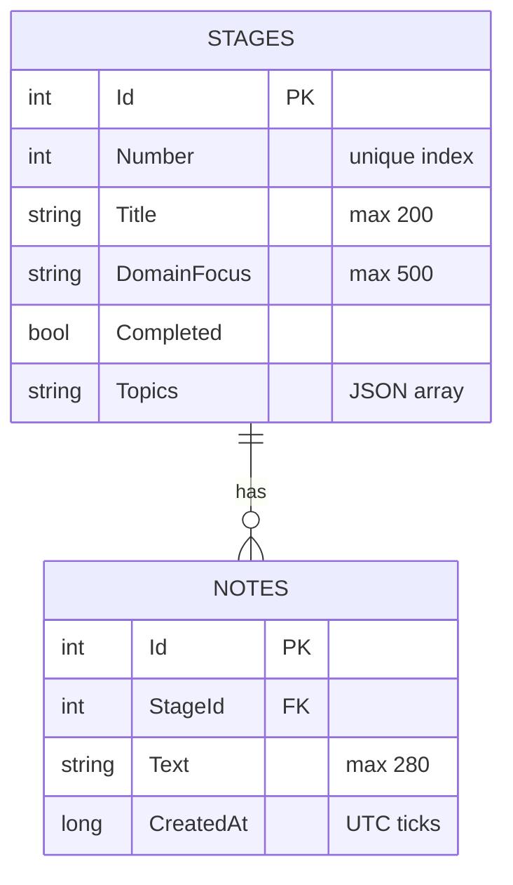

[`Data/Entities.cs`](src/LearnDotNet.Api/Data/Entities.cs) and [`Data/RoadmapDbContext.cs`](src/LearnDotNet.Api/Data/RoadmapDbContext.cs):

```csharp
public sealed class StageEntity
{
    public int Id { get; set; }
    public int Number { get; set; }
    public required string Title { get; set; }
    public required string DomainFocus { get; set; }
    public bool Completed { get; set; }
    public List<string> Topics { get; set; } = [];
    public List<NoteEntity> Notes { get; set; } = [];
}

public sealed class NoteEntity
{
    public int Id { get; set; }
    public int StageId { get; set; }
    public StageEntity? Stage { get; set; }
    public required string Text { get; set; }
    public DateTimeOffset CreatedAt { get; set; }
}

public sealed class RoadmapDbContext(DbContextOptions<RoadmapDbContext> options) : DbContext(options)
{
    public DbSet<StageEntity> Stages => Set<StageEntity>();
    public DbSet<NoteEntity> Notes => Set<NoteEntity>();

    protected override void OnModelCreating(ModelBuilder modelBuilder)
    {
        modelBuilder.Entity<StageEntity>(stage =>
        {
            stage.HasIndex(s => s.Number).IsUnique();
            stage.Property(s => s.Title).HasMaxLength(200);
            stage.Property(s => s.DomainFocus).HasMaxLength(500);
            stage.HasMany(s => s.Notes)
                .WithOne(n => n.Stage)
                .HasForeignKey(n => n.StageId)
                .OnDelete(DeleteBehavior.Cascade);
        });

        modelBuilder.Entity<NoteEntity>(note =>
        {
            note.Property(n => n.Text).HasMaxLength(280);
            note.Property(n => n.CreatedAt).HasConversion(
                v => v.UtcTicks,
                v => new DateTimeOffset(v, TimeSpan.Zero));
        });
    }
}
```

| Line / API | Role | What happens at runtime |
| :--- | :--- | :--- |
| `int Id` | Primary key by convention | A property named `Id` or `<Type>Id` becomes the key; integer keys are database-generated. |
| `required string Title` | Non-nullable column | C# `required` forces object initializers to set it; nullable reference types make the column `NOT NULL`. |
| `List<string> Topics` | Primitive collection (EF Core 8+) | Stored as a JSON array in one column, and still queryable (`s.Topics.Contains("Kestrel")`). |
| `int StageId` + `StageEntity? Stage` | Foreign key and navigation | The FK property avoids loading the stage just to link a note. |
| `HasIndex(...).IsUnique()` | Unique index | Duplicate stage numbers fail with a constraint violation, not a silent duplicate. |
| `HasConversion(v => v.UtcTicks, ...)` | Value converter | SQLite has no `datetimeoffset` type and cannot `ORDER BY` the default text format, so ticks are stored. SQL Server and PostgreSQL do not need this. |
| `DbSet<T> => Set<T>()` | Query roots | An expression-bodied property avoids a nullable warning on an uninitialised auto-property. |

Registration and provider choice live in `Program.cs`. The provider package decides the database:

| Database | Package | Options call |
| --- | --- | --- |
| SQLite | `Microsoft.EntityFrameworkCore.Sqlite` | `UseSqlite(cs)` |
| SQL Server / Azure SQL | `Microsoft.EntityFrameworkCore.SqlServer` | `UseSqlServer(cs)` / `UseAzureSql(cs)` |
| PostgreSQL | `Npgsql.EntityFrameworkCore.PostgreSQL` | `UseNpgsql(cs)` |
| MySQL / MariaDB | `Pomelo.EntityFrameworkCore.MySql` or `MySql.EntityFrameworkCore` | `UseMySql(...)` |
| Cosmos DB | `Microsoft.EntityFrameworkCore.Cosmos` | `UseCosmos(...)` |

### 3.7 Querying: LINQ Translation, Projection and Tracking

A LINQ query on a `DbSet` builds an expression tree. Nothing runs until you enumerate it (`ToListAsync`, `FirstOrDefaultAsync`, `CountAsync`, `await foreach`). EF Core then translates the tree to SQL, caches the translation, executes it and materialises results.

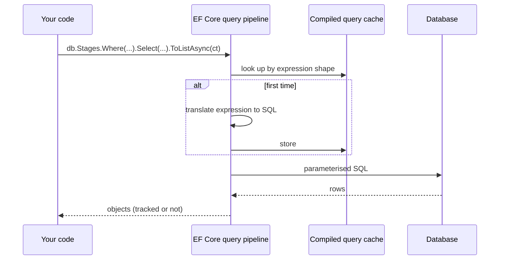

The starter's read path:

```csharp
public async Task<IReadOnlyList<RoadmapStage>> GetAllStagesAsync(CancellationToken cancellationToken) =>
    await db.Stages
        .AsNoTracking()
        .OrderBy(s => s.Number)
        .Select(s => new RoadmapStage(s.Number, s.Title, s.DomainFocus, s.Completed, s.Topics))
        .ToListAsync(cancellationToken);
```

The SQL it produces (with `Microsoft.EntityFrameworkCore.Database.Command` logging at `Information`, which `appsettings.Development.json` turns on):

```sql
SELECT "s"."Number", "s"."Title", "s"."DomainFocus", "s"."Completed", "s"."Topics"
FROM "Stages" AS "s"
ORDER BY "s"."Number"
```

Three decisions drive query cost:

1. **Project with `Select`.** Selecting into a DTO reads only the columns you need and returns untracked objects. Loading whole entities to map them afterwards reads every column.
2. **Track only what you will change.** Tracking makes EF Core snapshot each entity so `SaveChanges` can detect changes; that costs memory and CPU. `AsNoTracking()` skips it for read-only queries. Projections into non-entity types are never tracked.
3. **Avoid N+1.** Lazy access to a navigation inside a loop sends one query per row.

```csharp
// N+1: one query for stages, then one per stage for its notes (if lazy loading is on),
// or empty Notes collections if it is off.
var stages = await db.Stages.ToListAsync(ct);
foreach (var s in stages) Console.WriteLine(s.Notes.Count);

// One query with a JOIN, or a subquery, computed by the database
var counts = await db.Stages
    .Select(s => new { s.Number, NoteCount = s.Notes.Count })
    .ToListAsync(ct);

// Eager loading when you need the entities themselves
var withNotes = await db.Stages.Include(s => s.Notes).AsSplitQuery().ToListAsync(ct);
```

`AsSplitQuery()` loads each included collection with its own SQL statement instead of one big JOIN. A JOIN repeats the parent columns for every child row (a "cartesian explosion" when several collections are included); split queries avoid that at the cost of extra round trips and no single-snapshot consistency.

Query operators that cannot be translated throw at runtime:

```text
System.InvalidOperationException: The LINQ expression 'DbSet<StageEntity>().Where(s => MyHelper(s.Title))'
could not be translated. Either rewrite the query in a form that can be translated, or switch to client
evaluation explicitly by inserting a call to 'AsEnumerable', 'AsAsyncEnumerable', 'ToList', or 'ToListAsync'.
```

Inserting `AsEnumerable()` before the filter "fixes" it by downloading the whole table. Rewrite the predicate with translatable operations instead.

Raw SQL is available when LINQ is the wrong tool, and interpolated values become parameters, not string concatenation:

```csharp
var minNumber = 3;
var stages = await db.Stages
    .FromSql($"SELECT * FROM Stages WHERE Number >= {minNumber}")
    .AsNoTracking()
    .ToListAsync(ct);
```

### 3.8 Migrations: Evolving the Schema Safely

The starter calls `EnsureCreatedAsync()`, which creates the schema from the model if the database does not exist. It cannot change an existing schema, and it skips the migrations history table, so a database created this way cannot later be migrated. Real applications use migrations: versioned C# files that describe each schema change.

```bash
# One-time setup
dotnet tool install --global dotnet-ef
dotnet package add Microsoft.EntityFrameworkCore.Design --project src/LearnDotNet.Api

# Create a migration from the difference between the model and the last snapshot
dotnet ef migrations add InitialCreate --project src/LearnDotNet.Api --output-dir Data/Migrations

# Apply pending migrations to the configured database
dotnet ef database update --project src/LearnDotNet.Api

# Produce a SQL script for review, safe to run against any version
dotnet ef migrations script --idempotent --project src/LearnDotNet.Api -o migrate.sql

# Produce a self-contained executable that applies migrations (no SDK needed at deploy time)
dotnet ef migrations bundle --project src/LearnDotNet.Api --self-contained -r linux-x64 -o efbundle

# Fail CI when someone changed the model without adding a migration
dotnet ef migrations has-pending-model-changes --project src/LearnDotNet.Api
```

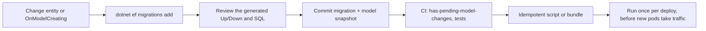

| Strategy | How | Good for | Risk |
| --- | --- | --- | --- |
| `EnsureCreated()` | At startup | Demos, tests, prototypes | Cannot evolve the schema |
| `Database.Migrate()` at startup | In `Program.cs` | Single-instance apps | Several replicas race to migrate; the app needs DDL permissions |
| SQL script | `migrations script --idempotent` run by a DBA or pipeline | Regulated environments, review of every statement | Manual step |
| Migration bundle | `efbundle` run as a Kubernetes Job or pipeline step | Containerised deployments | Must run before the new version takes traffic |

Write migrations that old and new code can both survive, because during a rolling deploy both versions run against the same database. Renaming a column, for example, takes three releases: add the new column and write to both; backfill and switch reads; drop the old column.

### 3.9 Saving Data: Change Tracking, Bulk Updates and Transactions

Tracked entities are saved by changing them and calling `SaveChangesAsync`. EF Core compares each tracked entity with its snapshot, generates `INSERT`, `UPDATE` and `DELETE` statements for what changed, batches them, and runs them in one transaction.

```csharp
public async Task<RoadmapStage?> SetCompletedAsync(int stageNumber, bool completed, CancellationToken cancellationToken)
{
    var stage = await db.Stages.FirstOrDefaultAsync(s => s.Number == stageNumber, cancellationToken);
    if (stage is null)
    {
        return null;
    }

    stage.Completed = completed;                    // change detected by snapshot comparison
    await db.SaveChangesAsync(cancellationToken);   // UPDATE "Stages" SET "Completed" = @p0 WHERE "Id" = @p1
    return new RoadmapStage(stage.Number, stage.Title, stage.DomainFocus, stage.Completed, stage.Topics);
}
```

Entity states the change tracker uses:

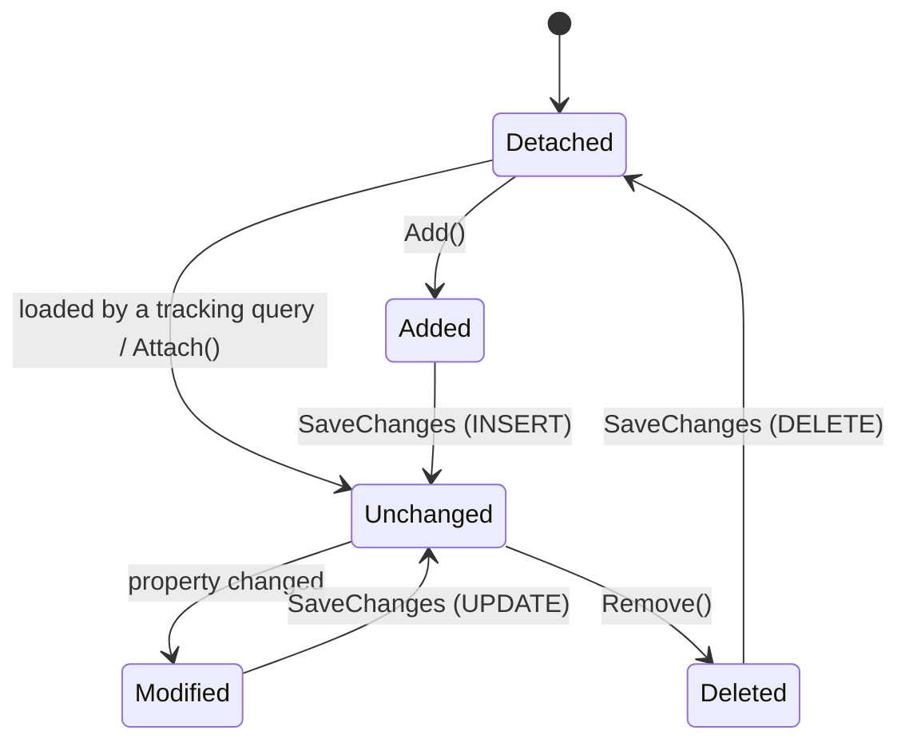

For set-based changes, `ExecuteUpdateAsync` and `ExecuteDeleteAsync` send one SQL statement without loading entities. They bypass the change tracker, so entities already tracked in the same context are not updated:

```csharp
// Reset every stage after Stage 3, in one UPDATE
var reset = await db.Stages
    .Where(s => s.Number > 3)
    .ExecuteUpdateAsync(setters => setters.SetProperty(s => s.Completed, false), ct);

// EF Core 10: setters can be built with ordinary code
await db.Stages.Where(s => s.Number == 4).ExecuteUpdateAsync(setters =>
{
    setters.SetProperty(s => s.Completed, true);
    if (renameRequested)
    {
        setters.SetProperty(s => s.Title, newTitle);
    }
}, ct);
```

`SaveChangesAsync` is already transactional. When one business operation needs several `SaveChanges` calls or a mix of tracked saves and `ExecuteUpdate`, wrap them explicitly:

```csharp
await using var tx = await db.Database.BeginTransactionAsync(ct);
await db.Stages.Where(s => s.Number == 7).ExecuteUpdateAsync(s => s.SetProperty(x => x.Completed, true), ct);
db.Notes.Add(new NoteEntity { StageId = stageId, Text = "Finished the handbook", CreatedAt = clock.GetUtcNow() });
await db.SaveChangesAsync(ct);
await tx.CommitAsync(ct);   // disposing without Commit rolls back
```

When the provider's retrying execution strategy is on (`EnableRetryOnFailure`), a user-initiated transaction must run inside `db.Database.CreateExecutionStrategy().ExecuteAsync(...)`, so the whole unit is retried, not just the failed statement.

### 3.10 Optimistic Concurrency

Two requests read the same row, both change it, both save: the second silently overwrites the first ("lost update"). Optimistic concurrency detects it without locking. A concurrency token is included in the `WHERE` clause of every `UPDATE`; if another writer changed the row, zero rows match and EF Core throws `DbUpdateConcurrencyException`.

```csharp
public class OrderEntity
{
    public Guid Id { get; set; }
    public decimal TotalAmount { get; set; }
    public string Status { get; set; } = "Pending";

    // SQL Server: a rowversion column that the database bumps on every write
    [Timestamp]
    public byte[] RowVersion { get; set; } = [];
}
```

| Database | Token | Mapping |
| --- | --- | --- |
| SQL Server | `rowversion` | `[Timestamp] byte[] RowVersion` |
| PostgreSQL (Npgsql) | the system column `xmin` | `[Timestamp] uint Version` |
| SQLite, others | an application-managed value | `[ConcurrencyCheck] Guid Version`, set to `Guid.NewGuid()` on every update |

Handling the conflict in an endpoint:

```csharp
app.MapPut("/orders/{id:guid}/status", async (Guid id, string status, OrderDbContext db, CancellationToken ct) =>
{
    var order = await db.Orders.FindAsync([id], ct);
    if (order is null) return Results.NotFound();

    order.Status = status;
    try
    {
        await db.SaveChangesAsync(ct);
        return Results.NoContent();
    }
    catch (DbUpdateConcurrencyException)
    {
        // Someone else saved first. Let the client reload and decide.
        return Results.Problem("The order was changed by another request. Reload and retry.",
            statusCode: StatusCodes.Status409Conflict);
    }
});
```

Over HTTP, send the token to the client as an ETag and expect it back in `If-Match` (the Stage 2 exercise), so the check covers the time the user spent looking at the form, not only the milliseconds between your read and your write.

### 3.11 DbContext Pooling and Compiled Queries

Creating a `DbContext` is cheap but not free: each one sets up internal services and a change tracker. `AddDbContextPool` keeps a pool of contexts and resets each one when its scope ends, instead of discarding it:

```csharp
builder.Services.AddDbContextPool<ApplicationDbContext>(options =>
{
    options.UseNpgsql(builder.Configuration.GetConnectionString("Postgres"), npgsql =>
    {
        npgsql.EnableRetryOnFailure(maxRetryCount: 3, maxRetryDelay: TimeSpan.FromSeconds(5), errorCodesToAdd: null);
        npgsql.UseQuerySplittingBehavior(QuerySplittingBehavior.SplitQuery);
    });

    // A read-mostly service can make no-tracking the default and opt in with AsTracking().
    options.UseQueryTrackingBehavior(QueryTrackingBehavior.NoTracking);
}, poolSize: 1024);
```

Pooling has rules: the context's constructor must only take `DbContextOptions<T>`, because the instance is reused across requests, and any state you add to the context (a tenant id field, for example) leaks into the next request unless you reset it. The pool size caps pooled instances, not concurrent requests; extra contexts are created and discarded when the pool is empty.

EF Core already caches query translations, but it must still hash the expression tree on every call to find the cache entry. A compiled query does that work once:

```csharp
using Microsoft.EntityFrameworkCore;

public static class CompiledQueries
{
    public static readonly Func<RoadmapDbContext, int, CancellationToken, Task<StageEntity?>> StageByNumber =
        EF.CompileAsyncQuery((RoadmapDbContext db, int number, CancellationToken ct) =>
            db.Stages.AsNoTracking().FirstOrDefault(s => s.Number == number));
}

// usage
var stage = await CompiledQueries.StageByNumber(db, 3, ct);
```

Measure before reaching for either. Pooling and compiled queries help at thousands of requests per second on simple queries; for most services, missing indexes and over-fetching cost far more.

| Technique | Saves | When it pays off | Cost |
| --- | --- | --- | --- |
| `Select` projection | Columns, tracking, materialisation | Almost always | Write a DTO |
| `AsNoTracking()` | Snapshots, identity resolution | Read-only queries | Entities cannot be saved without `Attach`/`Update` |
| `AddDbContextPool` | Context setup per request | High request rates | No per-request state in the context |
| `EF.CompileAsyncQuery` | Expression tree hashing and cache lookup | Very hot, simple queries | Less flexible, a separate API |
| `ExecuteUpdateAsync` | Loading rows, change tracking | Set-based changes | Bypasses tracking and `SaveChanges` interceptors |

### 3.12 Testing the Data Layer

Use a real relational provider in tests. The EF Core in-memory provider is not a database: it ignores transactions, constraints and SQL translation, so tests pass against it and fail against SQL Server. SQLite in memory is fast and relational, and the starter's [`RoadmapServiceTests`](tests/LearnDotNet.Tests/RoadmapServiceTests.cs) uses it:

```csharp
public sealed class RoadmapServiceTests : IDisposable
{
    private readonly SqliteConnection _connection = new("Data Source=:memory:");
    private readonly RoadmapDbContext _db;

    public RoadmapServiceTests()
    {
        _connection.Open();   // the in-memory database lives as long as this connection is open
        var options = new DbContextOptionsBuilder<RoadmapDbContext>()
            .UseSqlite(_connection)
            .UseSeeding((context, _) => RoadmapSeed.Seed(context))
            .Options;
        _db = new RoadmapDbContext(options);
        _db.Database.EnsureCreated();
    }

    public void Dispose()
    {
        _db.Dispose();
        _connection.Dispose();
    }

    [Fact]
    public async Task Note_limit_from_options_is_enforced()
    {
        var service = new RoadmapService(_db, new StaticSnapshot(new RoadmapOptions { Title = "Test", MaxNotesPerStage = 1 }),
            new FixedClock(new DateTimeOffset(2026, 11, 3, 9, 30, 0, TimeSpan.Zero)));

        Assert.IsType<NoteResult.Created>(await service.AddNoteAsync(2, "first note", CancellationToken.None));
        var second = await service.AddNoteAsync(2, "second note", CancellationToken.None);

        Assert.Equal(1, Assert.IsType<NoteResult.LimitReached>(second).Limit);
    }
}
```

| Test double | Fidelity | Speed | Use for |
| --- | --- | --- | --- |
| EF Core in-memory provider | Low: no SQL, no constraints, no transactions | Fastest | Avoid for data-layer tests |
| SQLite in memory | Medium: relational, but SQLite's SQL dialect | Fast | Service and query tests, as here |
| Testcontainers with the production database | High | Seconds per container | Migrations, provider-specific SQL, concurrency tokens |
| Repository interface mocked | None for data access | Fastest | Testing callers of the data layer, not the data layer |

`FixedClock` is a three-line `TimeProvider` subclass that returns a fixed instant, which is why the service takes `TimeProvider` rather than calling `DateTimeOffset.UtcNow`. The `Microsoft.Extensions.TimeProvider.Testing` package offers `FakeTimeProvider` with `Advance()` for timer-driven code.

### 3.13 Pitfalls

| Pitfall | Symptom | Fix |
| --- | --- | --- |
| Scoped service captured by a singleton | Development: `Cannot consume scoped service 'RoadmapDbContext' from singleton '...'`. Production: cross-request data leaks, `A second operation was started on this context instance before a previous operation completed.` | Make the consumer scoped, or create a scope per unit of work with `IServiceScopeFactory`. |
| One scope for a whole `BackgroundService` | Memory grows steadily; stale data from the change tracker | Create a scope inside the loop, per iteration. |
| `DbContext` used from two threads (`Task.WhenAll` on one context) | `InvalidOperationException: A second operation was started on this context instance...` | One context per concurrent operation, or run the queries sequentially. |
| Unbounded queries (`db.Notes.ToListAsync()`) | Memory spikes, long GC pauses, timeouts as tables grow | Paginate (`Skip`/`Take` or keyset), project, and stream with `AsAsyncEnumerable()`. |
| Client evaluation workaround with `AsEnumerable()` | Whole table downloaded; slow only in production-sized data | Rewrite the predicate so it translates; check the logged SQL. |
| `EnsureCreated()` followed later by migrations | `SQLite Error 1: 'table "Stages" already exists'` on the first `database update` | Use migrations from the first deployment that matters. |
| Data annotations on options without `ValidateOnStart()` | Bad settings surface as 500s on the first request that reads them | Chain `.ValidateOnStart()`. |
| `IOptions<T>` where reload is expected | Edited `appsettings.json` has no effect until restart | `IOptionsSnapshot<T>` (scoped) or `IOptionsMonitor<T>` (singleton). |
| EF Core in-memory provider in tests | Tests pass, production fails on constraints or translation | SQLite in memory or Testcontainers. |
| Ignoring `DbUpdateConcurrencyException` | Lost updates, or 500s under contention | Concurrency token plus a 409 response. |
| State fields on a pooled `DbContext` | One tenant's filter applied to another tenant's request | Keep pooled contexts stateless, or reset state in a pooled-context factory. |

### 3.14 Best Practices

- Give every class one public constructor that lists its dependencies: the DI graph is visible in code review.
- Default to scoped for anything that touches a `DbContext`, singleton only for thread-safe stateless services: lifetime bugs are the hardest DI bugs to find.
- Turn on scope validation in every environment you can afford: captive dependencies fail fast instead of leaking data.
- Bind settings to options classes and validate on start: misconfiguration fails the deployment, not a user request.
- Use `TryAdd*` in library registration code: applications can override your defaults.
- Project queries to DTOs and use `AsNoTracking()` for reads: fewer columns, less memory, no accidental writes.
- Pass `CancellationToken` to every EF Core call: abandoned requests stop their SQL.
- Keep entities out of HTTP contracts: schema changes do not break clients, and clients cannot over-post fields such as `Id`.
- Use migrations, reviewed as code, applied by a pipeline step or bundle: schema changes are repeatable and auditable.
- Write migrations that old and new application versions both tolerate: rolling deploys do not break.
- Test the data layer against a relational database: the in-memory provider hides real failures.

### 3.15 Hands-on Exercise

Add a search endpoint and a schema change.

1. Add `GET /api/v1/roadmap/search?topic=Kestrel&page=1&size=10` that returns stages whose `Topics` contain the topic, ordered by number. Use the `Paging` binder from Stage 2.5, project to `RoadmapStage`, and pass the `CancellationToken`.
2. Add a nullable `CompletedAt` (`DateTimeOffset?`) to `StageEntity`, set it from `TimeProvider` in `SetCompletedAsync` when a stage is completed, and clear it when it is uncompleted. Return it in `RoadmapStage`.
3. Replace `EnsureCreatedAsync()` with migrations: add `Microsoft.EntityFrameworkCore.Design`, run `dotnet ef migrations add InitialCreate`, then `dotnet ef migrations add AddCompletedAt`, and call `db.Database.MigrateAsync()` at startup.
4. Write a service test with the in-memory SQLite setup from 3.12 that completes a stage with a `FixedClock` and asserts `CompletedAt` equals the clock's time.

Expected output from step 1:

```json
[
  { "stageNumber": 1, "title": ".NET Platform, C# & the ASP.NET Core Host", "completed": true, "keyTopics": ["dotnet CLI", "SDK-style csproj", "WebApplicationBuilder", "Kestrel"], "domainFocus": "..." }
]
```

The service to extend is [`Services/RoadmapService.cs`](src/LearnDotNet.Api/Services/RoadmapService.cs); the seed data that defines each stage's topics is [`Data/RoadmapSeed.cs`](src/LearnDotNet.Api/Data/RoadmapSeed.cs).

[Back to top ⤴️](#-table-of-contents)

---

## 4. Stage 4: Security, Background Work & Real-Time

Authentication turns a token into a user, authorization decides what that user may do, background services run work outside the request, and SignalR pushes messages to connected clients. This stage builds on the pipeline order from Stage 2.2 and the scopes from Stage 3.3.

### 4.1 Securing Web APIs with JWT Bearer Authentication

The `Microsoft.AspNetCore.Authentication.JwtBearer` package validates bearer tokens on every request. Every validation flag below should stay on; turning one off is how forged tokens get accepted.

```csharp
using System.Text;
using Microsoft.AspNetCore.Authentication.JwtBearer;
using Microsoft.IdentityModel.Tokens;

builder.Services.AddAuthentication(JwtBearerDefaults.AuthenticationScheme)
    .AddJwtBearer(options =>
    {
        options.TokenValidationParameters = new TokenValidationParameters
        {
            ValidateIssuer = true,
            ValidateAudience = true,
            ValidateLifetime = true,
            ValidateIssuerSigningKey = true,
            ValidIssuer = builder.Configuration["Jwt:Issuer"],
            ValidAudience = builder.Configuration["Jwt:Audience"],
            // The key comes from user secrets or a secret store, never from appsettings.json.
            IssuerSigningKey = new SymmetricSecurityKey(
                Encoding.UTF8.GetBytes(builder.Configuration["Jwt:SigningKey"]!)),
            ClockSkew = TimeSpan.FromSeconds(30)
        };
    });

builder.Services.AddAuthorization(options =>
{
    options.AddPolicy("RequireAdminTier", policy =>
        policy.RequireRole("PlatformAdmin").RequireClaim("security_clearance", "Level3"));
});
```

With an external identity provider (Entra ID, Auth0, Keycloak), set `options.Authority` instead of a symmetric key: the handler downloads the provider's signing keys from its OpenID Connect discovery document and rotates them automatically.

### 4.2 Custom Policy Authorization Handlers

A requirement is data; a handler is the logic that decides whether the current user meets it. The handler below checks a date-of-birth claim:

```csharp
using Microsoft.AspNetCore.Authorization;

public record MinimumAgeRequirement(int MinimumAge) : IAuthorizationRequirement;

public sealed class MinimumAgeHandler(TimeProvider clock) : AuthorizationHandler<MinimumAgeRequirement>
{
    protected override Task HandleRequirementAsync(AuthorizationHandlerContext context, MinimumAgeRequirement requirement)
    {
        var claim = context.User.FindFirst("date_of_birth");
        if (claim is not null && DateOnly.TryParse(claim.Value, out var dob))
        {
            var today = DateOnly.FromDateTime(clock.GetUtcNow().UtcDateTime);
            var age = today.Year - dob.Year;
            if (dob > today.AddYears(-age)) age--;

            if (age >= requirement.MinimumAge)
            {
                context.Succeed(requirement);
            }
        }

        // Not calling Succeed leaves the requirement unmet; Fail() would veto other handlers too.
        return Task.CompletedTask;
    }
}

// Program.cs
builder.Services.AddSingleton<IAuthorizationHandler, MinimumAgeHandler>();
builder.Services.AddAuthorization(o => o.AddPolicy("Over18", p => p.AddRequirements(new MinimumAgeRequirement(18))));
app.MapGet("/restricted", () => "ok").RequireAuthorization("Over18");
```

### 4.3 Scalable Real-Time Push with SignalR and a Redis Backplane

SignalR picks the best transport the client supports (WebSockets, then server-sent events, then long polling) and gives you hubs, groups and typed clients on top. A WebSocket stays attached to one server instance, so with several replicas a message sent on instance A must reach clients connected to instance B. A backplane (Redis pub/sub, or Azure SignalR Service) relays it.

```csharp
using Microsoft.AspNetCore.SignalR;

public sealed class OrderTrackingHub : Hub
{
    public Task JoinOrderGroup(string orderId) =>
        Groups.AddToGroupAsync(Context.ConnectionId, $"order-{orderId}");

    public Task LeaveOrderGroup(string orderId) =>
        Groups.RemoveFromGroupAsync(Context.ConnectionId, $"order-{orderId}");
}

// Program.cs (package: Microsoft.AspNetCore.SignalR.StackExchangeRedis)
builder.Services.AddSignalR(options =>
{
    options.EnableDetailedErrors = false;
    options.KeepAliveInterval = TimeSpan.FromSeconds(15);
})
.AddStackExchangeRedis(builder.Configuration.GetConnectionString("Redis")!);

app.MapHub<OrderTrackingHub>("/hubs/orders");
```

Without the Azure service, a load balancer in front of several instances also needs sticky sessions, because the SignalR negotiate request and the connection that follows must reach the same server.

### 4.4 Periodic Background Services (`BackgroundService`)

`BackgroundService` runs `ExecuteAsync` when the host starts and cancels `stoppingToken` on shutdown. `PeriodicTimer` ticks without overlapping runs and without blocking a thread between ticks.

```csharp
public sealed class HeartbeatMonitor(ILogger<HeartbeatMonitor> logger) : BackgroundService
{
    protected override async Task ExecuteAsync(CancellationToken stoppingToken)
    {
        using var timer = new PeriodicTimer(TimeSpan.FromSeconds(30));

        while (await timer.WaitForNextTickAsync(stoppingToken))
        {
            logger.LogInformation("Heartbeat at {Time}", DateTimeOffset.UtcNow);
        }
    }
}

builder.Services.AddHostedService<HeartbeatMonitor>();
```

Since .NET 6 an unhandled exception in `ExecuteAsync` stops the host by default (`BackgroundServiceExceptionBehavior.StopHost`). Catch and log per iteration when one failed run should not take the service down.

[Back to top ⤴️](#-table-of-contents)

---

## 5. Stage 5: API Design, gRPC & Testing

Contract-first service-to-service APIs with gRPC, HTTP API design, and the testing pyramid for ASP.NET Core. The starter's integration tests already use `WebApplicationFactory<Program>`, which this stage explains in depth.

### 5.1 gRPC Service Implementation

gRPC sends Protocol Buffers messages over HTTP/2 streams. The `.proto` file is the contract; `Grpc.AspNetCore` generates C# base classes and clients from it at build time. Messages are binary and compact, and streaming in either direction is built in.

```protobuf
syntax = "proto3";

option csharp_namespace = "Ordering.Grpc";

service OrderStreamService {
  rpc StreamOrderUpdates (OrderSubscriptionRequest) returns (stream OrderStatusMessage);
}

message OrderSubscriptionRequest {
  string customer_id = 1;
}

message OrderStatusMessage {
  string order_id = 1;
  string status = 2;
  double total_amount = 3;
}
```

```csharp
using Grpc.Core;
using Ordering.Grpc;

public sealed class OrderStreamServiceImpl : OrderStreamService.OrderStreamServiceBase
{
    public override async Task StreamOrderUpdates(
        OrderSubscriptionRequest request,
        IServerStreamWriter<OrderStatusMessage> responseStream,
        ServerCallContext context)
    {
        // The token fires when the client cancels or disconnects.
        while (!context.CancellationToken.IsCancellationRequested)
        {
            await responseStream.WriteAsync(new OrderStatusMessage
            {
                OrderId = Guid.NewGuid().ToString(),
                Status = "Shipped",
                TotalAmount = 249.99
            });
            await Task.Delay(1000, context.CancellationToken);
        }
    }
}

// Program.cs
builder.Services.AddGrpc();
app.MapGrpcService<OrderStreamServiceImpl>();
```

Use `double` only for illustration: money belongs in an integer number of minor units (`int64 total_cents`) or the `google.type.Money` message, because binary floating point cannot represent most decimal amounts exactly.

[Back to top ⤴️](#-table-of-contents)

---

## 6. Stage 6: Performance, Resilience, Observability & Deployment

What keeps a service fast and running under real traffic: caching, resilience against failing dependencies, health probes for orchestrators, and telemetry that explains what happened.

### 6.1 `HybridCache`: L1 + L2 Caching with Stampede Protection

`HybridCache` (package `Microsoft.Extensions.Caching.Hybrid`, generally available since early 2025, works on .NET 8 and later) combines an in-process memory cache (L1) with any `IDistributedCache` such as Redis (L2). When a hot key expires and a hundred requests ask for it at once, only one runs the factory; the others wait for its result. That is stampede protection.

```csharp
using Microsoft.Extensions.Caching.Hybrid;

builder.Services.AddHybridCache(options =>
{
    options.DefaultEntryOptions = new HybridCacheEntryOptions
    {
        Expiration = TimeSpan.FromMinutes(10),          // L2 lifetime
        LocalCacheExpiration = TimeSpan.FromMinutes(2)  // L1 lifetime: shorter, limits staleness per pod
    };
});

app.MapGet("/api/catalog/{id}", async (string id, HybridCache cache, ICatalogDb db, CancellationToken ct) =>
    await cache.GetOrCreateAsync(
        $"catalog-item:{id}",
        async cancel => await db.FetchItemAsync(id, cancel),
        cancellationToken: ct));

public interface ICatalogDb
{
    Task<CatalogItem?> FetchItemAsync(string id, CancellationToken ct);
}

public record CatalogItem(string Id, string Name, decimal Price);
```

### 6.2 Polly v8 Resilience Pipelines

Polly v8 composes strategies into a `ResiliencePipeline`. Order matters: strategies added first wrap the ones added later, so here the retry wraps the circuit breaker, which wraps the per-attempt timeout.

```csharp
using Polly;
using Polly.CircuitBreaker;
using Polly.Retry;

var pipeline = new ResiliencePipelineBuilder<HttpResponseMessage>()
    .AddRetry(new RetryStrategyOptions<HttpResponseMessage>
    {
        MaxRetryAttempts = 3,
        Delay = TimeSpan.FromMilliseconds(200),
        BackoffType = DelayBackoffType.Exponential,
        UseJitter = true
    })
    .AddCircuitBreaker(new CircuitBreakerStrategyOptions<HttpResponseMessage>
    {
        FailureRatio = 0.5,
        SamplingDuration = TimeSpan.FromSeconds(10),
        MinimumThroughput = 8,
        BreakDuration = TimeSpan.FromSeconds(30)
    })
    .AddTimeout(TimeSpan.FromSeconds(2))
    .Build();
```

For `HttpClient`, `Microsoft.Extensions.Http.Resilience` wraps a tuned version of this pipeline in one call: `builder.Services.AddHttpClient<CatalogClient>().AddStandardResilienceHandler();`.

### 6.3 Health Checks for Kubernetes Probes

Liveness asks "is the process stuck?"; readiness asks "can it serve traffic now?". Keep dependency checks out of liveness, or a database outage makes Kubernetes restart every healthy pod.

```csharp
using Microsoft.AspNetCore.Diagnostics.HealthChecks;

// AddNpgSql and AddRedis come from the community AspNetCore.HealthChecks.NpgSql / .Redis packages.
builder.Services.AddHealthChecks()
    .AddNpgSql(builder.Configuration.GetConnectionString("Postgres")!, name: "postgres", tags: ["ready"])
    .AddRedis(builder.Configuration.GetConnectionString("Redis")!, name: "redis", tags: ["ready"])
    .AddCheck("self", () => Microsoft.Extensions.Diagnostics.HealthChecks.HealthCheckResult.Healthy(), tags: ["live"]);

var app = builder.Build();

app.MapHealthChecks("/health/ready", new HealthCheckOptions { Predicate = check => check.Tags.Contains("ready") });
app.MapHealthChecks("/health/live", new HealthCheckOptions { Predicate = check => check.Tags.Contains("live") });
```

### 6.4 OpenTelemetry Traces and Metrics

ASP.NET Core, `HttpClient` and the runtime already emit `Activity` traces and `System.Diagnostics.Metrics` instruments. OpenTelemetry collects them and exports over OTLP to any backend.

```csharp
using OpenTelemetry.Metrics;
using OpenTelemetry.Resources;
using OpenTelemetry.Trace;

builder.Services.AddOpenTelemetry()
    .ConfigureResource(resource => resource.AddService("ordering-api"))
    .WithTracing(tracing => tracing
        .AddAspNetCoreInstrumentation()
        .AddHttpClientInstrumentation()
        .AddEntityFrameworkCoreInstrumentation()   // separate, pre-release instrumentation package
        .AddOtlpExporter())
    .WithMetrics(metrics => metrics
        .AddAspNetCoreInstrumentation()
        .AddHttpClientInstrumentation()
        .AddRuntimeInstrumentation()
        .AddOtlpExporter());
```

### 6.5 Pitfalls

| Pitfall | Symptom | Fix |
| --- | --- | --- |
| Large session or catalog data in `IMemoryCache` on load-balanced pods | Each pod shows different data; pods are OOM-killed as the cache grows | Bound the cache (`SizeLimit`), or use a distributed cache or `HybridCache` with a short `LocalCacheExpiration`. |
| Dependency checks in the liveness probe | A database outage restarts every pod, turning a partial outage into a full one | Dependencies in readiness only. |
| Retrying non-idempotent calls | Duplicate orders or payments after a timeout | Retry only idempotent operations, or send an idempotency key. |

[Back to top ⤴️](#-table-of-contents)

---

## M1. Masterclass: Kestrel, Pipelines & the Request Hot Path

How Kestrel turns socket bytes into an `HttpContext`: transport, `System.IO.Pipelines`, the memory pool, connection and stream lifetimes for HTTP/1.1, HTTP/2 and HTTP/3, and how to measure and tune them with `dotnet-counters` and `dotnet-trace`.

[Back to top ⤴️](#-table-of-contents)

---

## M2. Masterclass: Resilience Engineering with Polly v8 and HybridCache

Designing for failing dependencies end to end: timeouts budgets, retries with jitter, circuit breakers, hedging, rate limiting, cache stampede protection and tag-based invalidation, tested with injected faults.

[Back to top ⤴️](#-table-of-contents)

---

## M3. Masterclass: Native AOT, Trimming and Startup Performance

Publishing ASP.NET Core with `PublishAot`, what the request delegate generator and JSON source generation replace, trimming warnings and how to fix them, and image size and startup comparisons against JIT builds.

[Back to top ⤴️](#-table-of-contents)

---

## M4. Masterclass: Observability with OpenTelemetry and .NET Aspire

Custom `ActivitySource` spans and `Meter` instruments, trace context propagation across HTTP and queues, log correlation, and running a local telemetry dashboard with .NET Aspire.

[Back to top ⤴️](#-table-of-contents)

---

## M5. Masterclass: Flagship Blueprint: Resilient Order Management Service

An end-to-end service that combines minimal APIs, validation, keyed services, EF Core and problem details from Stages 1-3. The version below runs as a single file; later sections of this masterclass add authentication, resilience, caching and telemetry.

```csharp
using System.ComponentModel.DataAnnotations;
using Microsoft.EntityFrameworkCore;

var builder = WebApplication.CreateBuilder(args);

builder.Services.AddProblemDetails();
builder.Services.AddValidation();
builder.Services.AddSingleton(TimeProvider.System);
builder.Services.AddDbContextPool<OrderDbContext>(options =>
    options.UseSqlite(builder.Configuration.GetConnectionString("Orders") ?? "Data Source=orders.db"));

// One payment gateway per provider, selected by key
builder.Services.AddKeyedScoped<IPaymentGateway, StripePaymentGateway>("stripe");
builder.Services.AddKeyedScoped<IPaymentGateway, AdyenPaymentGateway>("adyen");

var app = builder.Build();

await using (var scope = app.Services.CreateAsyncScope())
{
    await scope.ServiceProvider.GetRequiredService<OrderDbContext>().Database.EnsureCreatedAsync();
}

app.UseExceptionHandler();

var orders = app.MapGroup("/api/v1/orders").WithTags("Orders");

orders.MapPost("/", async (
    CreateOrderDto dto,
    OrderDbContext db,
    [FromKeyedServices("stripe")] IPaymentGateway payments,
    TimeProvider clock,
    CancellationToken ct) =>
{
    var order = new OrderRecord { Id = Guid.NewGuid(), CustomerId = dto.CustomerId, Amount = dto.Amount, Status = "Pending", CreatedAt = clock.GetUtcNow() };
    db.Orders.Add(order);
    await db.SaveChangesAsync(ct);

    var paid = await payments.ChargeAsync(order.Id, order.Amount, ct);
    order.Status = paid ? "Paid" : "PaymentFailed";
    await db.SaveChangesAsync(ct);

    return paid
        ? Results.Created($"/api/v1/orders/{order.Id}", order)
        : Results.Problem("Payment authorization was rejected.", statusCode: StatusCodes.Status402PaymentRequired);
});

orders.MapGet("/{id:guid}", async (Guid id, OrderDbContext db, CancellationToken ct) =>
    await db.Orders.AsNoTracking().FirstOrDefaultAsync(o => o.Id == id, ct) is { } order
        ? Results.Ok(order)
        : Results.NotFound());

app.Run();

public record CreateOrderDto([Required] string CustomerId, [Range(0.01, 1_000_000)] decimal Amount);

public sealed class OrderRecord
{
    public Guid Id { get; set; }
    public required string CustomerId { get; set; }
    public decimal Amount { get; set; }
    public required string Status { get; set; }
    public DateTimeOffset CreatedAt { get; set; }
}

public interface IPaymentGateway
{
    Task<bool> ChargeAsync(Guid orderId, decimal amount, CancellationToken ct);
}

public sealed class StripePaymentGateway : IPaymentGateway
{
    public Task<bool> ChargeAsync(Guid orderId, decimal amount, CancellationToken ct) => Task.FromResult(true);
}

public sealed class AdyenPaymentGateway : IPaymentGateway
{
    public Task<bool> ChargeAsync(Guid orderId, decimal amount, CancellationToken ct) => Task.FromResult(true);
}

public sealed class OrderDbContext(DbContextOptions<OrderDbContext> options) : DbContext(options)
{
    public DbSet<OrderRecord> Orders => Set<OrderRecord>();

    protected override void OnModelCreating(ModelBuilder modelBuilder) =>
        // SQLite has no decimal type; storing the value as text keeps it exact.
        modelBuilder.Entity<OrderRecord>().Property(o => o.Amount).HasConversion<string>();
}
```

The order is saved as `Pending` before the charge, then updated with the outcome, so a crash between the two steps leaves a record that a reconciliation job can find. A production version charges with an idempotency key derived from the order id, so a retried request cannot charge twice.

[Back to top ⤴️](#-table-of-contents)

---

## 7. Stage 7: Staff .NET Backend Engineer Interview Handbook & Cheatsheet

Questions are grouped by depth. Answers explain the mechanism and the trade-off, the way a staff-level interviewer expects.

### 7.1 Core Concepts (Q1-Q10)

#### Q1. What is the difference between `WebApplicationBuilder` and the legacy `Startup.cs` model?

`Startup.cs` split configuration into `ConfigureServices` (fill the `IServiceCollection`) and `Configure` (build the `IApplicationBuilder` pipeline), and the host discovered those methods by convention. `WebApplicationBuilder` (.NET 6+) puts configuration, logging, service registration and pipeline construction in one linear `Program.cs`: services go on `builder.Services`, `builder.Build()` creates the container, and the returned `WebApplication` is both the pipeline builder and the endpoint route builder.

The practical gains are readability and fewer moving parts: no convention-based method discovery, and configuration values are available while you register services. Both models run on the same generic host, so `Startup` classes still work; new code and templates use minimal hosting, and .NET 10 marks the older `WebHostBuilder` APIs obsolete.

#### Q2. How does Kestrel handle many concurrent connections efficiently?

Kestrel uses the operating system's asynchronous socket APIs (epoll on Linux, kqueue on macOS, I/O completion ports on Windows) through .NET's socket transport, so a connection waiting for bytes does not occupy a thread. Incoming data is read into buffers rented from a pinned memory pool and exposed through `System.IO.Pipelines`, and the HTTP parser works directly on `ReadOnlySequence<byte>` segments instead of copying into new arrays. Buffers return to the pool when parsing is done.

The result is that steady-state request processing allocates little, so the GC runs rarely, and a small number of thread-pool threads serve a large number of connections. Throughput limits then come from your own code: blocking calls, large allocations, or slow dependencies.

#### Q3. What is a captive dependency and how do you resolve it?

A captive dependency is a service with a longer lifetime holding a service with a shorter one, typically a singleton taking a scoped `DbContext` in its constructor. The scoped instance then lives as long as the singleton, is shared by every request and thread, and its change tracker grows forever. Symptoms are cross-request data leaks, memory growth and `A second operation was started on this context instance` exceptions.

Fix it by making the consumer scoped, or, when it must be a singleton (a `BackgroundService`), inject `IServiceScopeFactory` and create a scope per unit of work. ASP.NET Core detects the problem at startup in Development through `ValidateScopes` and `ValidateOnBuild`; enabling those in other environments catches it everywhere.

#### Q4. When should you use minimal APIs rather than MVC controllers?

Minimal APIs suit new HTTP APIs and microservices: endpoints are explicit, filters and route groups cover cross-cutting concerns, they support Native AOT, and .NET 10 adds built-in validation. At startup the framework generates a `RequestDelegate` for each handler (at compile time with the request delegate generator under AOT), so there is no controller activation or multi-stage filter pipeline per request.

Controllers remain a good choice for existing MVC codebases, teams that rely on action filter conventions and model-state behaviour of `[ApiController]`, and apps that also render MVC views. Both share routing, authorization and OpenAPI and can coexist in one app, so migration can be gradual.

#### Q5. How does `AddDbContextPool` improve performance over `AddDbContext`?

`AddDbContext` creates a new context per scope, which sets up internal services and a change tracker each time. `AddDbContextPool` keeps up to `poolSize` contexts (1024 by default) and, when a scope ends, resets the context's state and returns it to the pool instead of discarding it.

The savings matter at high request rates with simple queries. The constraints: the context constructor may only take `DbContextOptions<T>`, and any custom state on the context survives into the next request unless you reset it, which is a correctness risk in multi-tenant code.

#### Q6. What problem does `HybridCache` solve?

It combines a fast in-process cache (L1) with a shared distributed cache (L2, for example Redis) behind one `GetOrCreateAsync` call, and it collapses concurrent misses for the same key into a single factory call. Without that, a popular key expiring sends every concurrent request to the database at once (a cache stampede).

It also handles serialization for L2, supports tags for group invalidation, and lets you set a shorter L1 lifetime than L2 to bound how stale one pod's copy can be.

#### Q7. What do `UseRouting()` and the endpoint middleware each do?

`UseRouting()` matches the request against the route table and stores the selected endpoint and route values on `HttpContext` (`context.GetEndpoint()`); it does not run the handler. The endpoint middleware, added with `UseEndpoints()` in older code and automatically at the end of the pipeline by `WebApplication`, executes the selected endpoint.

Middleware placed between the two, such as CORS, authentication and authorization, can therefore read the endpoint's metadata (`[Authorize]`, CORS policy, rate-limit policy) before the handler runs. With `WebApplication` you rarely call either explicitly; call `UseRouting()` yourself only when some middleware must run before routing.

#### Q8. What are endpoint filters and how do they differ from MVC action filters?

Endpoint filters (`IEndpointFilter`) wrap a single minimal API endpoint or a route group. They run after parameter binding, can read and change the bound arguments, and can short-circuit by returning a result. They form one simple chain.

MVC action filters belong to the MVC pipeline, which has several filter stages (authorization, resource, action, exception, result) and works with `ModelState`. Endpoint filters are lighter and cover the common cases; MVC filters offer more hooks for apps that need them.

#### Q9. Why should you pass `CancellationToken` to database and HTTP calls?

When a client disconnects or a gateway times out, ASP.NET Core cancels `HttpContext.RequestAborted`. A handler that passes that token to EF Core and `HttpClient` stops the SQL command and the downstream call; one that does not keeps consuming database connections and CPU to produce a response nobody will read. Under load that wasted work is what turns a slowdown into an outage.

#### Q10. How does SignalR scale across several server instances?

Each WebSocket is attached to one instance, so a message sent to a group from instance A would only reach group members connected to A. A backplane fixes that: with Redis, each instance publishes hub messages to a Redis channel and every instance delivers them to its own connections. Azure SignalR Service goes further and holds the client connections itself, so app instances keep only a few connections to the service. Without the managed service, the load balancer also needs sticky sessions for the negotiate step.

### 7.2 Internals & Performance (Q11-Q15)

#### Q11. What is the difference between `MapGet` and `MapControllers`?

`MapGet` registers one endpoint for a route and method directly in the route table. `MapControllers()` discovers controller classes in the application's assemblies and creates endpoints from their routing attributes (`[Route]`, `[HttpGet]`). Both produce the same kind of endpoint objects, so routing, authorization and OpenAPI treat them identically; the difference is how they are declared and what pipeline runs inside the endpoint.

#### Q12. What changed in Polly v8 compared with v7?

Polly v8 replaced policies with resilience pipelines built from strategies (`ResiliencePipelineBuilder`). Sync and async execution share one pipeline, the happy path is designed to avoid allocations, and strategies report telemetry through `System.Diagnostics.Metrics`. New strategies such as hedging arrived, and `Microsoft.Extensions.Resilience` and `Microsoft.Extensions.Http.Resilience` build on it to give DI-registered pipelines and a standard `HttpClient` handler.

#### Q13. What are keyed services and why were they added in .NET 8?

Keyed services register several implementations of one service type under different keys and resolve one by key, either with `[FromKeyedServices("key")]` on a parameter or `GetKeyedService<T>(key)`. Before .NET 8 you needed `IEnumerable<T>` filtering or a hand-written factory. They fit strategy selection by a known name: payment providers, notification channels, storage backends.

#### Q14. How does YARP work with ASP.NET Core?

YARP is a reverse-proxy library that runs inside an ASP.NET Core app. Routes and clusters come from configuration or code, and proxying happens in the middleware pipeline, so the usual building blocks apply: authentication, rate limiting, header transforms, health checks and load balancing between destinations. It is a common choice for API gateways and backend-for-frontend services written in .NET.

#### Q15. What is the difference between liveness and readiness probes?

Liveness tells the orchestrator whether the process is healthy enough to keep; failing it restarts the container, so it should check only the process itself. Readiness tells it whether the instance should receive traffic now; failing it removes the pod from load balancing without a restart, so it is where dependency checks (database, cache, broker) belong. Putting dependency checks in liveness turns a database blip into a restart storm.

[Back to top ⤴️](#-table-of-contents)

---

## 🧪 Example Projects

| Project | Builds on | What you practise | Stretch goal |
| --- | --- | --- | --- |
| [Roadmap API starter](src/LearnDotNet.Api) (in this repo) | [Stage 1](#1-stage-1-net-platform-c--the-aspnet-core-host), [Stage 2](#2-stage-2-request-pipeline-middleware-routing--minimal-apis), [Stage 3](#3-stage-3-dependency-injection-options--ef-core-data-access) | Minimal APIs, middleware, problem details, options validation, EF Core with SQLite, xUnit and `WebApplicationFactory` | Do the three stage exercises: options override, ETags, search and migrations |
| URL shortener | [2.4](#24-endpoint-routing-templates-constraints-and-precedence), [3.6](#36-ef-core-dbcontext-entities-and-relationships) | Route constraints, unique indexes, redirects | Click counting with `ExecuteUpdateAsync` and a daily cleanup `BackgroundService` |
| Multi-tenant notes API | [3.2](#32-service-lifetimes-and-the-captive-dependency-problem), [3.7](#37-querying-linq-translation-projection-and-tracking) | Scoped tenant context, global query filters | Named query filters (EF Core 10) for tenant and soft delete |
| Webhook relay | [2.7](#27-route-groups-and-endpoint-filters-iendpointfilter), [3.3](#33-scopes-outside-a-request-iservicescopefactory) | Signature-checking filter, a queue drained by a hosted service | Retries with Polly and a dead-letter table |
| Inventory service with concurrency | [3.10](#310-optimistic-concurrency), [2.13](#213-hands-on-exercise) | Concurrency tokens, ETags, 409/412 handling | Testcontainers tests against PostgreSQL with `xmin` |
| Settings service | [1.7](#17-configuration-environments-and-secrets), [3.5](#35-the-options-pattern-typed-validated-configuration) | Configuration providers, `IOptionsMonitor<T>` reload | A custom configuration provider backed by a database table |
| Order management service | [M5](#m5-masterclass-flagship-blueprint-resilient-order-management-service) | Keyed services, validation, EF Core | Idempotency keys and an outbox table |

## 📝 Cheat Sheets

### CLI / Commands

```bash
# SDK and runtimes
dotnet --info
dotnet --list-sdks
dotnet new globaljson --sdk-version 10.0.100 --roll-forward latestFeature

# New projects
dotnet new webapi -o Api                     # minimal API template
dotnet new webapi -o Api --use-controllers   # controllers instead
dotnet new xunit -o Api.Tests
dotnet new sln && dotnet sln add Api Api.Tests

# Packages and references (.NET 10 noun-first forms)
dotnet package add Npgsql.EntityFrameworkCore.PostgreSQL
dotnet package add Microsoft.Extensions.Http.Resilience
dotnet package add Microsoft.AspNetCore.Authentication.JwtBearer
dotnet package add OpenTelemetry.Extensions.Hosting
dotnet package list --outdated
dotnet reference add Api --project Api.Tests

# Build, run, test
dotnet build -c Release
dotnet run --project Api --launch-profile http
dotnet watch --project Api
dotnet test --filter "FullyQualifiedName~RoadmapApiTests"
dotnet format --verify-no-changes

# Secrets (Development only)
dotnet user-secrets init --project Api
dotnet user-secrets set "Jwt:SigningKey" "dev-only-value" --project Api

# EF Core
dotnet tool install --global dotnet-ef
dotnet ef migrations add InitialCreate --project Api
dotnet ef database update --project Api
dotnet ef migrations script --idempotent -o migrate.sql --project Api
dotnet ef migrations bundle --self-contained -r linux-x64 --project Api

# Publish
dotnet publish Api -c Release -o out
dotnet publish Api -c Release -r linux-x64 -p:PublishAot=true   # needs AOT-compatible code
dotnet publish Api -c Release -t:PublishContainer                # builds an OCI image without a Dockerfile

# Diagnostics (install once with dotnet tool install -g <tool>)
dotnet-counters monitor -n Api System.Runtime Microsoft.AspNetCore.Hosting
dotnet-trace collect -n Api
dotnet-dump collect -n Api
```

### Production `appsettings.json` Blueprint

Non-secret settings only. Connection strings with passwords and signing keys arrive as environment variables (`ConnectionStrings__Postgres`, `Jwt__SigningKey`) from the platform's secret store.

```json
{
  "Logging": {
    "LogLevel": {
      "Default": "Information",
      "Microsoft.AspNetCore": "Warning",
      "Microsoft.EntityFrameworkCore.Database.Command": "Warning"
    }
  },
  "AllowedHosts": "api.example.com",
  "ConnectionStrings": {
    "Redis": "redis.internal:6379,abortConnect=false"
  },
  "Jwt": {
    "Issuer": "https://auth.example.com",
    "Audience": "https://api.example.com"
  }
}
```

### ASP.NET Core Quick Reference

| Task | Code |
| --- | --- |
| Map a GET with a route value | `app.MapGet("/items/{id:int}", (int id) => ...)` |
| Group routes | `var g = app.MapGroup("/api/v1/items").WithTags("Items");` |
| Typed result union | `Task<Results<Ok<Item>, NotFound>>` |
| Problem response | `TypedResults.Problem(title: "...", statusCode: 409)` |
| Enable .NET 10 validation | `builder.Services.AddValidation();` |
| Global exception handler | `AddExceptionHandler<T>()` + `AddProblemDetails()` + `app.UseExceptionHandler()` |
| Endpoint filter | `.AddEndpointFilter<MyFilter>()` |
| Scoped service | `builder.Services.AddScoped<IService, Service>();` |
| Keyed service | `AddKeyedSingleton<ISender, SmsSender>("sms")` + `[FromKeyedServices("sms")]` |
| Validated options | `AddOptions<T>().BindConfiguration("S").ValidateDataAnnotations().ValidateOnStart()` |
| Scope in a worker | `await using var scope = scopes.CreateAsyncScope();` |
| Read-only query | `db.Items.AsNoTracking().Select(i => new ItemDto(...)).ToListAsync(ct)` |
| Bulk update | `db.Items.Where(...).ExecuteUpdateAsync(s => s.SetProperty(i => i.Flag, true), ct)` |
| Health endpoint | `builder.Services.AddHealthChecks(); app.MapHealthChecks("/health");` |
| OpenAPI document | `builder.Services.AddOpenApi(); app.MapOpenApi();` |

## 📚 Resources

- [.NET documentation](https://learn.microsoft.com/dotnet/)
- [ASP.NET Core documentation](https://learn.microsoft.com/aspnet/core/)
- [Entity Framework Core documentation](https://learn.microsoft.com/ef/core/)
- [C# language documentation](https://learn.microsoft.com/dotnet/csharp/)
- [What's new in .NET 10](https://learn.microsoft.com/dotnet/core/whats-new/dotnet-10/overview)
- [What's new in ASP.NET Core in .NET 10](https://learn.microsoft.com/aspnet/core/release-notes/aspnetcore-10.0)
- [.NET release notes and support policy](https://github.com/dotnet/core/tree/main/release-notes)
- [.NET Blog](https://devblogs.microsoft.com/dotnet/)
- [dotnet/runtime](https://github.com/dotnet/runtime), [dotnet/aspnetcore](https://github.com/dotnet/aspnetcore), [dotnet/efcore](https://github.com/dotnet/efcore) source repositories
- [Official .NET container images](https://mcr.microsoft.com/catalog?search=dotnet)

## 🤝 Contributing

Contributions are welcome. Read the [contributing guide](https://github.com/TheLearningHubOrg/.github/blob/main/CONTRIBUTING.md) and the [code of conduct](https://github.com/TheLearningHubOrg/.github/blob/main/CODE_OF_CONDUCT.md) before you open a pull request. Commit messages follow [Conventional Commits](https://www.conventionalcommits.org/), which drive the automated changelog.

## 📄 License

This project is licensed under the MIT License. See the [LICENSE](LICENSE) file for details.

## 🙏 Acknowledgments

- [.NET](https://dotnet.microsoft.com/) and the ASP.NET Core and EF Core teams and contributors
- [SQLite](https://sqlite.org/) and [Microsoft.Data.Sqlite](https://learn.microsoft.com/dotnet/standard/data/sqlite/), used by the starter project
- [xUnit.net](https://xunit.net/), the starter's test framework
- [OpenTelemetry .NET](https://github.com/open-telemetry/opentelemetry-dotnet) and [Polly](https://github.com/App-vNext/Polly), used in Stage 6

## 🌐 Connect with me

- [Twitter](https://twitter.com/manthan_ank)
- [LinkedIn](https://www.linkedin.com/in/manthanank)
- [Facebook](https://www.facebook.com/manthanank/)
- [Instagram](https://www.instagram.com/manthan_ank/)
- [YouTube](https://www.youtube.com/@manthanank)
- [GitHub](https://github.com/manthanank)

## ☕ Support

If you like this learning repository and find it useful, consider buying me a coffee or sponsoring me through GitHub Sponsors. Your support helps me keep these guides up to date. Thank you!

[](https://www.buymeacoffee.com/manthanank)

[](https://github.com/sponsors/manthanank)

---

Show your support by 🌟 the repository.
